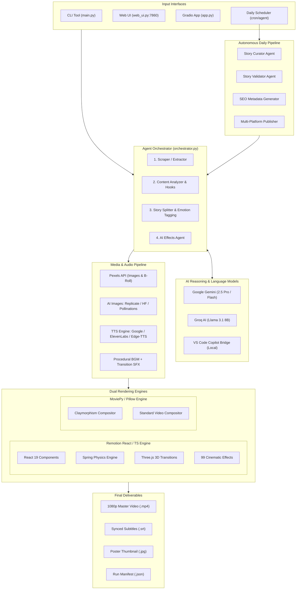
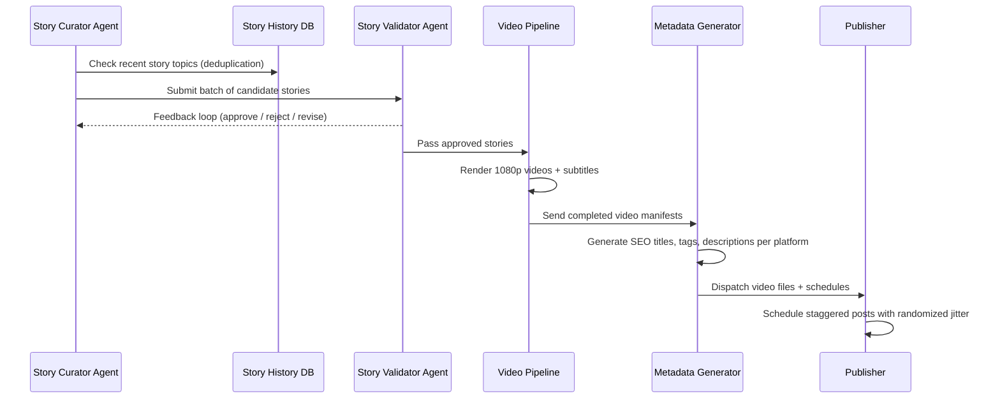

# 🎬 Project HER v2.0 — Next-Gen AI Video Agent

> **Turn any article, web link, or text idea into a studio-grade, fully produced video — automated from end to end, with zero human editing required.**

---

## 📌 Table of Contents

1. [Executive Overview](#-executive-overview)
2. [High-Level Architecture](#-high-level-architecture)
3. [The End-to-End Generation Pipeline](#-the-end-to-end-generation-pipeline)
4. [Core Features & Capabilities](#-core-features--capabilities)
   - [Content Modes & Story Generation](#1-content-modes--story-generation)
   - [Visual Engine & AI Image Generation](#2-visual-engine--ai-image-generation)
   - [Dual Video Rendering Engine](#3-dual-video-rendering-engine-remotion--moviepy)
   - [Voice Narration & Word-Level Lip Sync](#4-voice-narration--word-level-lip-sync)
   - [Sound Design & Procedural Audio](#5-sound-design--procedural-audio)
   - [Effects, Physics & Motion Graphics](#6-effects-physics--motion-graphics)
5. [Autonomous Daily Publishing Agent](#-autonomous-daily-publishing-agent)
6. [VS Code Copilot LM Bridge](#-vs-code-copilot-lm-bridge)
7. [User Interfaces](#-user-interfaces)
   - [Interactive Flask Web UI](#1-interactive-flask-web-ui-web_uipy)
   - [Hugging Face Spaces App](#2-hugging-face-spaces-app-apppy)
   - [Terminal CLI](#3-terminal-cli-mainpy)
8. [CLI Command Reference](#-cli-command-reference)
9. [Configuration & Environment Variables](#-configuration--environment-variables)
10. [Repository Structure & Code Index](#-repository-structure--code-index)
11. [Installation & Deployment](#-installation--deployment)

---

## 🌟 Executive Overview

**Project HER v2.0** is an autonomous AI production system designed to produce short-form and long-form video content at scale (TikTok, YouTube Shorts, Instagram Reels, YouTube Landscape, LinkedIn, and Twitter/X).

Traditional video creation involves separate steps for scriptwriting, voice recording, asset sourcing, caption synchronization, animation, motion graphics, audio mixing, and platform formatting. Project HER unifies these into an orchestrated pipeline governed by autonomous AI agents:

- **Ingests any input**: Live URLs, raw markdown, story notes, or simple questions.
- **Narrative Intelligence**: Extracts emotional beats, pacing shifts, visual prompts, and hooks.
- **Visual Synthesis**: Fetches royalty-free stock or generates tailored visuals via a 3-tier fallback AI image chain.
- **Dual Video Rendering**: Choose between **Remotion** (React 19, TypeScript, Three.js, spring physics, and 99 effects) or **MoviePy** (Python-native card compositing).
- **Zero-Touch Publishing**: An autonomous multi-agent daily pipeline handles story discovery, validation, rendering, SEO metadata generation, and scheduled distribution.

---

## 📐 High-Level Architecture



---

## 🔄 The End-to-End Generation Pipeline

Every video run goes through a 6-stage lifecycle:

```
[1. SCRAPE] ──▶ [2. ANALYZE] ──▶ [3. VISUALS] ──▶ [4. NARRATE] ──▶ [5. EFFECTS] ──▶ [6. COMPOSE]
```

1. **Scraping & Ingestion (`agent/scraper.py`)**  
   Extracts article body, title, and metadata from arbitrary URLs while filtering out ads, navigation, and boilerplate. Raw text or local files can also be passed directly.
2. **Analysis & Narrative Arc (`agent/analyzer.py`, `agent/story_splitter.py`)**  
   Breaks the narrative into chronological screen segments. For each segment, the LLM determines:
   - Voiceover narration copy (calibrated for timing).
   - On-screen bold headline.
   - Core emotion tag (`suspense`, `wonder`, `humor`, `urgency`, etc.).
   - Visual search or generation prompt.
   - Text placement (`top`, `center`, `bottom`) to avoid covering primary focal points.
3. **Visual Asset Sourcing (`agent/visuals.py`, `agent/ai_visuals.py`)**  
   - Stock mode: Async parallel querying and retrieval of high-resolution images or video clips from Pexels.
   - AI Image mode: Multi-tier image generation with style-specific prompt decoration.
4. **Narration Synthesis & Timestamp Alignment (`agent/narration.py`, `agent/google_tts.py`)**  
   Synthesizes speech and records word-level start and end timestamps. This allows accurate karaoke-style text highlighting during video rendering.
5. **AI Effects Planning (`agent/effects_agent.py`)**  
   Selects complementary text animations, image zooms, scene transitions, and ambient particle overlays matching the story's emotional progression.
6. **Video Composition (`agent/remotion_renderer.py` / `agent/compositor.py`)**  
   Stitches background tracks, voice audio, visual layers, typography, and motion effects into a 30 FPS, H.264 video file.

---

## 🚀 Core Features & Capabilities

### 1. Content Modes & Story Generation

Project HER supports 5 specialized operational modes configured via `--content-mode`:

| Mode | Identifier | Description | Best Suited For |
|---|---|---|---|
| **Article / URL** | `article` | Converts any web article, news post, or text document into a structured video. | Blog posts, news articles, case studies. |
| **Deep Dive** | `deep_dive` | NotebookLM-inspired multi-host conversational podcast with dynamic two-person dialogue. | Long-form analysis, complex explainers. |
| **Thought Experiment** | `thought_experiment` | Philosophical "what if" video based on a hypothetical question. | Science, philosophy, creative scenarios. |
| **Ghost Collaboration** | `ghost_collab` | Dual-voice discussion simulating a conversation with a historical or fictional figure. | History, education, commentary. |
| **Kids Story** | `kids_story` | High-energy children's story featuring curiosity hooks and punchy narrative arcs. | Viral short-form storytelling. |

#### Narrative Tone Presets
- `informative`: Neutral, clear, documentary/anchor delivery.
- `storytelling`: Emotional arc building tension and resolution.
- `social`: Punchy, viral pacing with quick hooks.
- `dramatic`: High cinematic tension and impact statements.
- `educational`: Clear, friendly explanation for learners.
- `motivational`: Uplifting, action-oriented delivery.
- `explainer`: Measured pacing tailored for progressive on-screen reveals.

---

### 2. Visual Engine & AI Image Generation

#### 3-Tier AI Image Generation Fallback Chain
When `--ai-images` is active, the system routes generation through a resilient fallback chain:

```
[Tier 1: Replicate] ────(if error/depleted)────▶ [Tier 2: HuggingFace] ────(if failed)────▶ [Tier 3: Pollinations.ai]
  FLUX Schnell / Pro                               FLUX.1-schnell API                             Free / Keyless
```

1. **Replicate (Primary)**: High-speed, high-resolution FLUX generation.
2. **HuggingFace Inference API (Secondary)**: Free cloud inference using FLUX.1-schnell.
3. **Pollinations.ai (Tertiary)**: Reliable, keyless fallback ensuring the pipeline never fails mid-render.

#### 7 Built-In Visual Design Styles
Configurable via `--visual-style`:

- **`claymorphism`** *(Default)*: Soft 3D matte clay characters, warm pastel backdrops, rounded cards, tactile depth.
- **`glassmorphism`**: Frosted glass surfaces, translucent blurs, clean lighting, and vibrant accents.
- **`skeuomorphism`**: Tactile textures, embossed elements, realistic shadows, leather and metal finishes.
- **`neo_brutalism`**: Bold black outlines, flat saturated color blocks, raw geometry, and high contrast.
- **`minimalism`**: Ample negative space, refined typography, and subtle monochromatic styling.
- **`liquid_glass`**: Iridescent chrome reflections, flowing translucent surfaces, holographic sheen.
- **`hyper_realistic`**: 8K photographic fidelity, shallow depth-of-field bokeh, and cinematic volumetric lighting.

---

### 3. Dual Video Rendering Engine (Remotion + MoviePy)

Project HER provides two independent rendering backends:

#### A. Remotion Engine (React 19 / TypeScript) ⭐ Default
- **Stack**: Remotion v4, React 19, TypeScript, Three.js (`@remotion/three`).
- **Spring Physics System**: 10 spring presets (`snappy`, `bouncy`, `smooth`, `heavy`, `elastic`, `gentle`, `pop`, `dramatic`, `tremor`, `soft_land`) mapped to scene emotions.
- **Multi-Layer Scene Compositor**: 5-tier scene layout:
  1. *Background Layer*: Animated auroras, gradient shifts, color pulses, or particle fields.
  2. *Image Layer*: Ken Burns pan/zoom, 3D tilt, parallax drift, and vignetting.
  3. *Typography Layer*: Word-by-word karaoke highlights, elastic drop-ins, and glitch entries.
  4. *Atmospheric Overlay Layer*: Film grain, bokeh, fire embers, rain, dust, scan lines, and VHS distortion.
  5. *Brand Bar*: Spring-animated logo and channel branding card.

#### B. MoviePy Engine (Python Native)
- Built on MoviePy 2.1 and Pillow.
- Renders rounded cards, drop shadows, color grading overlays, and dynamic kinetic typography without requiring Node.js.

---

### 4. Voice Narration & Word-Level Lip Sync

Supports multiple speech synthesis engines:

- **Google AI Studio / Gemini TTS**: High-fidelity voices with natural cadence and inflection.
- **ElevenLabs API**: Studio-quality conversational voices.
- **Microsoft Edge TTS**: 15+ built-in voices across 16+ languages (free, keyless).
- **Replicate Kokoro-82m**: Ultra-low-cost, high-speed neural TTS.
- **Word-Level Subtitle Alignment**: Real-time karaoke word tracking enables dynamic word highlighting synchronized with the audio.

---

### 5. Sound Design & Procedural Audio

- **Procedural BGM**: Synthesizes and matches background music chords and pacing to the overall story mood.
- **Transition SFX**: Injects custom transition sounds (whoosh, rise, pop) at scene cut boundaries.
- **Pacing Control**: Adds configurable micro-silence gaps (e.g., 300ms) between scenes to maintain comfortable speech cadence.

---

### 6. Effects, Physics & Motion Graphics

The workspace includes **180 registered Python effects** and **99 specialized Remotion TypeScript cinematic animations**:

```
├── Text Entry (26)          ─ Fade, Scale Bounce, Stamp, Elastic Drop, Glitch, 3D Flip, Typewriter
├── Text Exit (16)           ─ Dissolve, Evaporate, Explode, Vortex, Crumble, Swipe
├── Text Continuous (21)     ─ Glow Pulse, Shake, Neon Flash, Heartbeat, Float, 3D Wobble
├── Text Per-Char (8)        ─ Wave Reveal, Cascading Drop, Scramble
├── Scene Transitions (29)   ─ 3D Cube Rotate, 3D Page Flip, Ink Bleed, Glitch, Circle Wipe, Morph
├── Image Entry/Exit (17)    ─ 3D Entrance, Scale Pop, Slide, Blur Dissolve
├── Image Treatments (16)    ─ Ken Burns, Parallax 2D, Tilt Shift, Sepia Blend, Film Grain
├── Overlays (16)            ─ Bokeh, Fire Embers, Scan Lines, Rain, Dust Particles, VHS Noise
└── Animated Backgrounds (10)─ Aurora Waves, Particle Floats, Gradient Shifting, Color Breathe
```

---

## 🤖 Autonomous Daily Publishing Agent

Located in `automation/`, this subsystem runs an end-to-end publishing pipeline with minimal intervention:



### Supported Publishing Strategies
1. **Manual Mode**: Consolidates MP4s, thumbnails, and platform metadata into organized folders and opens them for review.
2. **YouTube Data API v3**: Direct, automated upload to YouTube Shorts.
3. **Browser Automation**: Playwright-driven uploads for web-based platform dashboards.
4. **macOS Shortcuts**: Dispatches payloads to macOS system shortcuts for automated sharing.

---

## 🔌 VS Code Copilot LM Bridge

Located in `vscode-copilot-bridge/`:
- A lightweight VS Code extension that exposes GitHub Copilot's models (`gpt-4o`, `o1-preview`) over a local HTTP daemon: `http://127.0.0.1:18945`.
- Provides an OpenAI-compatible endpoint (`/chat`, `/models`, `/health`).
- Allows the pipeline to use high-tier LLMs through your local VS Code Copilot subscription without incurring separate API costs.

---

## 🖥️ User Interfaces

### 1. Interactive Flask Web UI (`web_ui.py`)
Start with:
```bash
python web_ui.py
# Available at http://localhost:7860
```
- **Generator Tab**: Input URLs or text, choose voice, theme, format, and renderer.
- **Server-Sent Events (SSE)**: Real-time progress bar tracking each stage.
- **Remotion Studio**: Live interactive previewer for testing all 99 effects with local caching.
- **Daily Pipeline Dashboard**: Trigger, monitor, and inspect automated batch runs.
- **Security & Quotas**: Built-in IP rate limits and concurrency locks for cloud hosting.

### 2. Hugging Face Spaces App (`app.py`)
A self-contained Gradio application configured for free-tier Hugging Face Spaces (CPU/16GB). Wraps the pipeline in an intuitive GUI without needing Flask or external daemons.

### 3. Terminal CLI (`main.py`)
A developer-focused command line tool built with **Click** and **Rich** featuring formatted tables, colorful logs, and progress indicators.

---

## ⌨️ CLI Command Reference

### Common Generation Commands

```bash
# 1. Generate from an article URL (informative tone, vertical 9:16)
python main.py generate --url "https://example.com/tech-article" --tone informative

# 2. Generate with AI-generated visuals (Claymorphism style) and custom branding
python main.py generate --text "Your story here..." --ai-images --visual-style claymorphism --brand "TechPulse"

# 3. Target a specific platform preset
python main.py generate --url "https://..." --platform tiktok
python main.py generate --url "https://..." --platform youtube_shorts

# 4. Preview analysis and narrative arc without rendering video
python main.py preview --text "A long story to preview..." --tone dramatic

# 5. Full custom rendering run
python main.py generate \
  --text "In the heart of the ancient forest..." \
  --tone dramatic \
  --theme cinematic \
  --captions karaoke \
  --transition zoom_in \
  --color-grade warm \
  --quality high \
  --format vertical \
  --voice aria \
  -v
```

### Automation & Inspection Commands

```bash
# Run the autonomous daily pipeline (generates 5 videos and schedules them)
python main.py daily --videos 5 --publish manual

# Run daily pipeline in dry-run mode (generates without publishing)
python main.py daily --videos 3 --dry-run

# Inspect supported presets and components
python main.py voices      # List all 15+ TTS voices
python main.py themes      # List visual theme presets
python main.py captions    # List caption animation presets
python main.py tones       # List narrative tone presets
python main.py platforms   # List platform presets
python main.py grades      # List color grading profiles
python main.py languages   # List supported language codes
python main.py cache       # View or clear generation cache
```

---

## ⚙️ Configuration & Environment Variables

Copy `.env.example` to `.env` and configure your credentials:

```bash
cp .env.example .env
```

| Environment Variable | Description | Required / Optional |
|---|---|---|
| `GEMINI_API_KEY` | Google Gemini API key (for LLM reasoning & Google TTS) | **Required** (or `GROQ_API_KEY`) |
| `GROQ_API_KEY` | Groq API key for Llama 3.1 8B inference | **Required** (or `GEMINI_API_KEY`) |
| `PEXELS_API_KEY` | Pexels REST API key for stock photos and B-roll | **Required** (unless using `--ai-images`) |
| `REPLICATE_API_TOKEN` | Replicate token for FLUX image generation & Kokoro TTS | Optional (Recommended for AI Images) |
| `HF_API_TOKEN` | Hugging Face token for FLUX.1-schnell free inference | Optional (Fallback image provider) |
| `ELEVENLABS_API_KEY` | ElevenLabs API key for studio-quality TTS | Optional |
| `LLM_PROVIDER` | Default LLM provider: `gemini` or `groq` | Optional (Default: `gemini`) |
| `TTS_PROVIDER` | Default TTS provider: `google_tts`, `elevenlabs`, `edge_tts` | Optional (Default: `google_tts`) |
| `DEFAULT_RENDERER` | Default video renderer: `remotion` or `moviepy` | Optional (Default: `remotion`) |
| `DEFAULT_VIDEO_FORMAT`| Default orientation: `vertical`, `horizontal`, `square` | Optional (Default: `vertical`) |

---

## 📂 Repository Structure & Code Index

```text
project-HER/
├── agent/                         # Core agent pipeline modules
│   ├── orchestrator.py            # Master workflow coordination & stage tracking
│   ├── scraper.py                 # Web extraction via BeautifulSoup
│   ├── analyzer.py                # LLM narrative reasoning & key point extraction
│   ├── story_splitter.py          # Screen storyboard segmentation & emotion tagging
│   ├── visuals.py                 # Pexels stock finder & download client
│   ├── ai_visuals.py              # Multi-tier FLUX image generation client
│   ├── narration.py               # Edge-TTS synthesizer with word timestamps
│   ├── google_tts.py              # Google AI Studio / Gemini voice synthesizer
│   ├── elevenlabs_tts.py          # ElevenLabs API client
│   ├── replicate_tts.py           # Kokoro-82m speech synthesis
│   ├── effects_agent.py           # LLM agent for scene-level effect selection
│   ├── effects_catalog.py         # Catalog of 180 registered Python effects
│   ├── effects_engine.py          # MoviePy effect application engine
│   ├── remotion_renderer.py       # Python-to-Remotion asset bridge and CLI renderer
│   ├── compositor.py              # MoviePy video compositor
│   ├── clay_compositor.py         # Pillow-based claymorphism compositor
│   ├── audio_engine.py            # Procedural BGM synthesis and audio mixer
│   └── audio_utils.py             # Silence padding and SFX generator
│
├── automation/                    # Autonomous daily content system
│   ├── daily_pipeline.py          # Multi-video daily run coordinator
│   ├── story_curator.py           # Trending topic researcher and script drafter
│   ├── story_validator.py         # Quality validation gate and feedback loop
│   ├── story_history.py           # Cross-run deduplication store
│   ├── metadata_generator.py      # Platform-specific SEO and hashtag generator
│   └── publisher.py               # Staggered upload scheduler and publisher
│
├── remotion/                      # Remotion React 19 / TypeScript renderer
│   ├── src/
│   │   ├── Root.tsx               # Remotion composition registry
│   │   ├── Video.tsx              # Main video compositor & scene sequencer
│   │   ├── types.ts               # Zod validation schemas and prop interfaces
│   │   ├── components/            # Scene, TextBlock, ImageBlock, BrandBar
│   │   ├── effects/               # Text, image, background, and overlay animations
│   │   ├── transitions/           # 2D & 3D scene transitions
│   │   └── three/                 # Three.js 3D effect components
│   └── package.json               # Node.js dependencies
│
├── vscode-copilot-bridge/         # Local extension exposing Copilot models via HTTP
├── assets/                        # Static fonts, music samples, and SFX
├── templates/                     # Flask Jinja2 UI templates
├── data/                          # Persistent storage (story history, logs)
├── output/                        # Output directories for rendered videos
├── app.py                         # Hugging Face Spaces Gradio interface
├── web_ui.py                      # Interactive Flask web application
├── main.py                        # Terminal CLI application
├── config.py                      # Central configuration settings
├── Dockerfile                     # Docker configuration
└── requirements.txt               # Python package dependencies
```

---

## 🛠️ Installation & Deployment

### 1. Prerequisites
- **Python 3.9+**
- **Node.js 18+** & **npm** (Required for the Remotion renderer)
- **FFmpeg** installed on your system path

```bash
# macOS
brew install ffmpeg node

# Ubuntu / Debian
sudo apt-get update && sudo apt-get install -y ffmpeg
curl -fsSL https://deb.nodesource.com/setup_20.x | sudo -E bash -
sudo apt-get install -y nodejs
```

### 2. Python Environment Setup
```bash
# Clone and enter directory
cd project-HER

# Create and activate virtual environment
python3 -m venv .venv
source .venv/bin/activate

# Install Python dependencies
pip install -r requirements.txt
```

### 3. Remotion Node.js Setup
```bash
cd remotion
npm install
cd ..
```

### 4. Running the Project
```bash
# Run the Web UI
python web_ui.py

# Run via CLI
python main.py generate --text "Hello world story..."

# Run the Gradio interface
python app.py
```

### 5. Production Docker Deployment
Build and run the container:
```bash
docker build -t project-her .
docker run -p 7860:7860 --env-file .env project-her
```

---

*Project HER — Automated End-to-End AI Video Production.*

