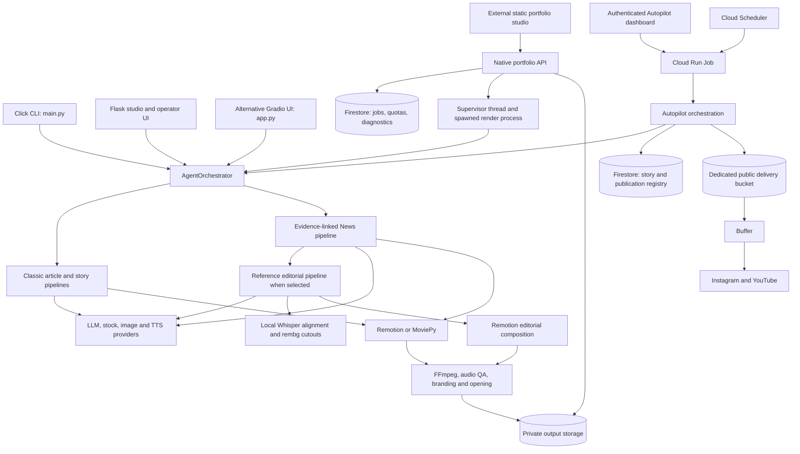

# Project HER: architecture, functionality, configuration, and deployment

Review date: 27 October 2026 (Asia/Kolkata).

This guide describes the checked-out application and infrastructure files. It separates implemented behavior, deployment observations made during this review/session, historical evidence, and proposed improvements. No deployments, billing changes, paid generations, or publications were performed for this review. Secret values are deliberately omitted.

## 1. What Project HER is

Project HER converts articles, URLs, topics, and stories into narrated videos. It combines language-model writing, source retrieval, image acquisition or generation, speech synthesis, word alignment, motion graphics, audio processing, and video export.

It is a Python application with a React/TypeScript rendering subsystem. It is not simply a static website or an application that runs entirely in a visitor's browser. Rendering uses Python processes, Node.js, Chromium, FFmpeg, and sometimes local machine-learning models.

There are three principal operational workflows:

| Workflow | Purpose | Main implementation |
|---|---|---|
| Manual creation | An operator creates and previews individual videos | `main.py`, `web_ui.py`, `agent/orchestrator.py` |
| Public portfolio studio | Visitors submit bounded jobs, follow progress, and retrieve private outputs | `agent/portfolio_api.py`, `agent/portfolio_store.py` |
| Autopilot | Generate a reserve of stories, validate videos, and publish through Buffer | `automation/autopilot.py`, `automation/autopilot_worker.py` |

A separate older daily-batch workflow also remains in `automation/daily_pipeline.py`. It must not be confused with the newer durable Autopilot workflow.

## 2. System architecture



The external portfolio frontend is documented in this repository but its full source is maintained separately. This review does not independently verify that site's current frontend deployment. The Flask backend exposes the API consumed by it.

## 3. Repository map

| Location | Responsibility |
|---|---|
| `main.py` | Click CLI; generation options and utility commands |
| `web_ui.py` | Flask pages, legacy APIs, SSE, history, previews, portfolio and Autopilot installation |
| `app.py` | Alternative Gradio/Hugging Face entry point |
| `config.py` | Central defaults, provider settings, themes, voices, formats, News and editorial settings |
| `agent/orchestrator.py` | Shared routing and classic generation orchestration; `PipelineResult` |
| `agent/news_*.py` | Source evidence, script, speech, subjects, layout, manifest, rendering |
| `agent/editorial/` | Reference editorial planning, assets, visual direction, alignment, rendering, QA |
| `agent/portfolio_api.py` | Public submission, capabilities, quotas, supervision, media access, operator diagnostics |
| `agent/portfolio_store.py` | SQLite/Firestore state and local/GCS media adapters |
| `agent/story_opening.py`, `agent/branding.py` | Shared opening, watermark, credits, and outro processing |
| `automation/` | Daily batch workflow, durable Autopilot, Buffer integration, cost reservations, quality gates |
| `remotion/src/` | React video compositions, scenes, effects, transitions, branding |
| `remotion/render.mjs` | Node rendering entry point |
| `templates/` | Flask HTML interfaces |
| `utils/` | LLM client, progress, caching, rendering resources, deployment guard |
| `scripts/` | Deployment, smoke checks, setup, validation, maintenance, cleanup tools |
| `deploy/autopilot/` | Terraform infrastructure template and example variable file |
| `tests/` | Offline regression tests across APIs, generation contracts, editorial work, publishing and diagnostics |
| `output/`, `temp/` | Generated media, scratch files, caches and diagnostic artifacts |
| `assets/` | Fonts, audio, brand resources and cached alignment models |
| `data/`, `series/` | Local automation/history and episodic story state |

## 4. User-facing functions and modes

### 4.1 Creation modes

| Mode | Behavior and scope |
|---|---|
| `article` | Extract article/URL/text, analyze key points and create a narrated video |
| `thought_experiment` | Build a philosophical or hypothetical narrative from a question |
| `ghost_collab` | Simulate a dialogue with a historical or fictional character; voice-pair options |
| `deep_dive` | Combine supplied sources into a two-host discussion |
| `kids_story` | Story-oriented short videos with curiosity hooks and pacing |
| `news` | Classify input, research or use supplied evidence, validate a script and produce cutout visuals |

The orchestrator also routes `story` and `topic` inputs into the reference editorial branch. That does not mean every UI exposes these as separate selectable modes.

The public portfolio API intentionally exposes only `news` and `article`; the full internal mode list is not its public contract.

### 4.2 Presentation and export controls

Implemented configuration includes vertical, horizontal and square formats; platform presets; tones; visual styles; caption styles; transitions; quality presets; color grading; voice selection; speed; music; branding; custom fonts; and intro/outro resources. Availability depends on the selected pipeline.

The reference editorial preset has stricter constraints: Remotion, vertical 1080×1920 output, `editorial` or `complete` text mode, and `auto`, `stock`, `ai`, or `local` asset mode. Public submissions omit local assets. Do not assume every classic theme/effect applies to editorial videos.

Series support carries episodic context and cliffhangers through local series files. Those files are excluded by `.dockerignore`, so local series continuity is not automatically deployed.

### 4.3 Operator conveniences

The Flask app includes generation, preview, result/progress retrieval, output/history/download access, series management, effect catalogs/previews, and the older daily pipeline. The default studio uses a fixed editorial configuration rather than freely accepting every option.

The Remotion rendering package has a local Studio command for composition development. This is distinct from the Flask effect-preview interface.

## 5. End-to-end video processing

### 5.1 Classic pipeline

1. Read a URL, text, file-derived input, question or dialogue prompt.
2. Scrape content when appropriate; analyze it with the selected LLM.
3. Build a screenplay with scene text, emotions, visual hints and speaker/layout information.
4. Acquire Pexels stock media or generated images, depending on the branch.
5. Synthesize narration and obtain available timing information.
6. Select effects and construct the composition.
7. Render through Remotion or a Python/MoviePy compositor.
8. Apply shared delivery treatments and return `PipelineResult` paths, metadata and errors.

Not every branch performs every operation in exactly this order; the orchestrator contains content-specific paths.

### 5.2 News pipeline

`agent/news_pipeline.py` reports these stages:

`resolve → research → script → subjects → cutouts → cutout_qa → narrate → timeline → compose`.

Input classification determines how supplied accounts, topics and URLs should be handled. Source policies are `auto`, `online`, and `supplied`. The research module retrieves bounded public sources, extracts passages and links evidence to the script. Serper is an optional search integration.

The pipeline creates a structured storyboard and validates subjects, fonts, masks, audio and timing. A Pydantic manifest passes the story, evidence, assets, audio and timeline to the renderer. AI likenesses are not automatically factual identity verification; generated-image caveats are retained in output metadata.

News supports Remotion and MoviePy. Hindi/Devanagari on MoviePy requires an appropriate text-shaping build; the code rejects unsupported shaping instead of knowingly rendering broken text.

### 5.3 Reference editorial pipeline

`agent/editorial/pipeline.py` reports:

`resolve → research → script → narrate → cutouts → timeline → compose`.

Its internal work includes:

- Evidence extraction and script approval.
- Visual cue planning and optional Autopilot scene validation before expensive assets.
- Speech synthesis, exact-script alignment and redundant padding removal.
- Background asset acquisition overlapping with alignment where possible; a CPU lock avoids concurrent expensive segmentation/alignment work.
- Entity images/cutouts and optional generated-likeness review.
- Narration-driven visual direction and semantic beat planning.
- Final master audio normalization and optional music mixing.
- Editorial timeline generation, Remotion rendering and audio/export measurement.
- Subtitles, thumbnail, image credits, manifests and failure diagnostics.

Local `faster-whisper` performs alignment on CPU with int8 computation. It is not another hosted speech API. `rembg`/ONNX Runtime perform local segmentation; their compute and RAM are still real server requirements.

### 5.4 Shared opening and branding

The shared story-opening decorator adds a title/cutout opening, updates subtitle offsets and metadata, and avoids adding it twice when an opening record exists. Branding includes watermarks, credits and an outro. Final runtime can exceed the requested narration target because speech timing and delivery segments are preserved.

A target duration is guidance, not an exact video-length guarantee.

## 6. Providers and external dependencies

| Capability | Implementation/integration | Important distinction |
|---|---|---|
| General text analysis | Gemini and Groq through the OpenAI-compatible Python client | Using the `openai` SDK does not prove OpenAI hosts these requests |
| Autopilot story intelligence | Configurable Replicate-backed story/model workflow | Separate from the general Gemini/Groq default |
| Stock visuals | Pexels | Requires credentials where this branch is selected |
| Generated images | Replicate, with HF/Pollinations integrations in applicable paths | Provider/fallback rules differ between classic and News |
| News/editorial images | FLUX-family models, reference images and verified/local assets | Call limits and identity handling apply |
| Speech | Edge TTS, Google TTS, ElevenLabs, Replicate Kokoro and Chatterbox integrations | Public and general defaults differ |
| Word alignment | Local faster-whisper | Image contains model files; CPU/RAM needed at runtime |
| Cutouts | Local rembg, ONNX Runtime, OpenCV/Pillow | Model cache and memory management are significant |
| Rendering | Remotion, React, Chromium; MoviePy/Pillow alternative | Server execution, not a frontend-only export |
| Media processing | FFmpeg | Encoding, probing, audio processing, thumbnails and delivery checks |
| Durable state/media | Firestore and Google Cloud Storage | Independent cloud services and billing |
| Publishing | Buffer to configured Instagram/YouTube channels | Needs a separately configured Buffer account and supported channels |

Current code defaults include Gemini model `gemini-3.5-flash-lite`, general `TTS_PROVIDER=google_tts`, and portfolio/studio Replicate narration. Model identifiers are code observations, not guarantees that providers still offer them in every account/region.

`NEWS_REPLICATE_ONLY` defaults to enabled. Therefore the general classic image fallback descriptions in old READMEs must not be interpreted as a guarantee that current News work falls back to free providers.

## 7. Public portfolio API and job execution

The API prefix is `/api/portfolio`.

| Route | Function |
|---|---|
| `GET /config` | Capabilities, defaults, limits and admission readiness |
| `POST /jobs` | Validate input and transactionally reserve a job using an idempotency key |
| `GET /submission` | Recover a submission acknowledgement without creating another job |
| `GET /jobs/<id>` | Job-scoped status and result |
| `GET /jobs/<id>/events` | Authenticated finite SSE stream; polling can recover progress |
| `POST /jobs/<id>/cancel` | Request supported cancellation |
| `GET/HEAD /jobs/<id>/media/<kind>` | Expiring media ticket, ranges, playback and download |
| `GET /operator/jobs/<id>/diagnostics` | Operator-authenticated JSON/JSONL diagnostics |

Public job states: `queued`, `running`, `completed`, `failed`, `cancelled`.

Creation accepts strict JSON, a random `Idempotency-Key` of 16–80 allowed characters, bounded inputs and allowed origins. The default schema supports English, Hindi and French; News-only voice/music controls do not automatically apply to classic jobs.

### Execution boundary

Public submission starts a supervisor thread. On Cloud Run, that supervisor spawns a killable Python child process for the actual rendering work. Heartbeats, deadlines, durable cancellation and descendant termination protect the job lifecycle. Expensive work is not replayed automatically if the worker dies.

**Public portfolio jobs currently run inside the web service instance. They are not dispatched to the separate Autopilot Cloud Run Job.** Firestore preserves state, but does not keep a terminated worker alive. This distinction is essential when considering scale-to-zero, request-based CPU or multiple web workers.

Default runtime deadline is 2700 seconds. Stale heartbeat detection can mark interrupted jobs failed. SSE streams are finite (about 55 seconds); clients must reconnect or poll. The browser need not keep one continuous HTTP request open for the entire render.

### Limits and admission

Code defaults: 10 global admissions/day, 2 per network identity/day, 1 concurrent public job; 6000 combined input characters, 16000 request bytes, URL limit 2048; duration 0 or 15–90 seconds and delivered-output ceiling 180 seconds. Failed admitted jobs count toward admission quotas.

Persisted policy can disable admissions, enable maintenance or alter daily-limit enforcement. Environment defaults alone do not prove the live policy. Shared networks/proxies may share a visitor quota; the default trusted-proxy-hop count is zero.

## 8. Storage, retention and recovery

| Data | Local development | Cloud architecture |
|---|---|---|
| Portfolio jobs/quotas/diagnostics | SQLite under local portfolio directory | Firestore `her_portfolio` |
| Portfolio video/media | Local media adapter | Private GCS bucket |
| Autopilot registry/settings/claims | `data/autopilot/autopilot.sqlite3` | Firestore `her_autopilot` |
| Publishable Autopilot videos/covers | Workflow-dependent local artifacts | Separate publicly readable delivery bucket |
| Rendering scratch and caches | `output/`, `temp/`, model directories | Ephemeral container filesystem plus build-baked models |
| Older daily history/series | Local JSON/SQLite/files | Not automatically durable without explicit external storage |

Portfolio job/output access normally expires after 48 hours. Media tickets last 30 minutes and can be renewed through authorized job status. Private-bucket lifecycle and Firestore TTL deletion are asynchronous; access expiry is not proof of immediate physical deletion.

Run diagnostics default to 14 days, configurable from 1–90 days. They retain bounded stage/failure/provider-warning metadata without raw submitted stories, prompts, credentials, signed URLs or absolute paths.

Autopilot retains private originals separately from public delivery assets. Public media cleanup requires confirmed publication on both platforms and the configured retention window. A blanket bucket-age deletion rule can break queued or ambiguous posts.

## 9. Autopilot and the older daily workflow

### 9.1 Durable Autopilot

The workflow curates candidates across mythology, fantasy, science fiction, folklore and other stories. It scores hook, tension, visual quality, originality, emotion, clarity and ending. Duplicate protection combines canonical identities/aliases, normalized text, hashes, narrative-event similarity and bounded semantic editorial review; it is not a guarantee of perfect semantic uniqueness.

Typical flow:

`candidate → reserved → generating → validated/prepared → ready → assigned → scheduled → remotely verified publication`.

Generation status and publication status are distinct. A validated render can survive a delivery failure as `PREPARED`; prepare/retry actions recover delivery instead of buying another render.

One video is assigned per IST publication day, with separate per-platform records. Buffer acceptance means scheduled, not published. Both platform records must confirm remote sent status for complete publication. Unknown mutation outcomes are reconciled rather than blindly recreated.

The dashboard routes `/autopilot` and `/dashboard` serve the administration UI. `/api/autopilot` and its settings/channels/actions endpoints require a sufficiently long `AUTOPILOT_ADMIN_TOKEN` bearer credential. Actions dispatch local subprocesses in development and Cloud Run Job executions in production.

Worker actions include `generate`, `prepare`, `schedule`, `verify`, `retry`, `dry-run`, `pipeline`, and `publish-now`. Explicit forced administrative work may run while normal scheduled Autopilot is paused. Pause does not cancel posts already scheduled in Buffer.

### 9.2 Infrastructure template

`deploy/autopilot/main.tf` defines a worker Job, scoped service accounts/IAM, public bucket, five Scheduler jobs, a failure log metric and a Monitoring alert policy. It defaults to paused schedulers, Autopilot disabled and Buffer dry-run; `example.tfvars` selects different example values. Neither file alone establishes actual production state.

| Action | Template schedule in Asia/Kolkata |
|---|---|
| Generate | 09:00, 11:00, 13:00, 15:00 |
| Prepare delivery | 10:10, 12:10, 14:10, 16:10 |
| Schedule | Every 10 minutes during hours 16–18 |
| Verify | Every 10 minutes during hours 18–23 |
| Retry | 18:05, 18:15, 18:25, 18:35, 18:45, 18:55 |

Default publication window is 18:00–19:00 IST, with preferred time 18:30. Late publication needs at least five minutes of lead time or the day is skipped. The ready inventory target is three. The current Settings class defaults daily reservation limit to $6; older documentation describing $2 is historical.

### 9.3 Older daily pipeline

`automation/daily_pipeline.py` separately curates, validates, generates, creates metadata and schedules batches. Its default target is five videos with manual publishing strategy; alternate strategies exist in `automation/publisher.py`. Its local history, timing and publishing assumptions are not equivalent to the durable Buffer-backed registry. Do not activate both independently without coordinating content and publishing.

## 10. Configuration types and precedence

There is no single universal configuration precedence chain across every module.

| Type | Examples | How it affects behavior |
|---|---|---|
| Code defaults | `config.py`, Pydantic defaults | Used when a branch has no override |
| Environment configuration | `.env`, runtime variables, Secret Manager bindings | Provider keys, models, feature flags, cloud resources |
| Request configuration | CLI flags, Flask JSON, `CreateJob` | Validated per-generation options |
| Fixed studio profile | `STUDIO_GENERATION_DEFAULTS` in `web_ui.py` | Explicitly overrides submitted studio options |
| Persistent operational settings | Firestore policy and Autopilot settings | Maintenance, enabled state, editable schedule/editorial settings |
| Process/container settings | Docker ENV, gunicorn flags | Runtime processes, ports, threads, caches |
| Infrastructure configuration | Terraform, deployment script, Cloud Run revision | CPU/RAM, scaling, IAM, secrets, schedules |
| Render contracts | Pydantic manifests, Zod/TypeScript schemas, timeline hashes | Data validity between Python and Remotion |
| Local assets/state | Asset registries, custom fonts/audio, series JSON | Input resources and continuity, subject to deployment exclusions |

`config.py` loads dotenv configuration. Existing process environment normally takes priority with standard dotenv loading. Public request validation can reject combinations even if equivalent internal parameters exist. Autopilot persisted dashboard values override relevant environment defaults.

### 10.1 Core environment settings

| Settings | Meaning/default from source |
|---|---|
| `LLM_PROVIDER`, `GEMINI_MODEL` | General LLM routing; Gemini default |
| `GEMINI_API_KEY`, `GOOGLE_API_KEY`, `GROQ_API_KEY` | Text-provider credentials/aliases |
| `TTS_PROVIDER`, `DEFAULT_VOICE`, `VOICE_SPEED` | General speech defaults; Google TTS default |
| `GOOGLE_TTS_API_KEY`, `ELEVENLABS_API_KEY`, `REPLICATE_API_TOKEN` | Speech/provider credentials |
| `PEXELS_API_KEY`, `HF_API_TOKEN`, `POLLINATIONS_API_KEY`, `SERPER_API_KEY` | Stock, image and research integrations |
| `DEFAULT_RENDERER`, `DEFAULT_VIDEO_FORMAT`, `DEFAULT_VISUAL_STYLE` | Remotion, vertical, claymorphism defaults |
| `DEFAULT_THEME`, `DEFAULT_CAPTION_STYLE` | Classic cinematic/karaoke defaults |
| `VIDEO_WATERMARK_TEXT`, `HER_BRANDING_JSON` | Shared branding; JSON controls enabled elements/timing |
| `CUSTOM_FONT_PATH`, `CUSTOM_INTRO_PATH`, `CUSTOM_OUTRO_PATH`, `CUSTOM_BGM_PATH` | Optional local delivery resources |
| `PORT` | Local Flask default 7860; Docker default 8080; cloud can inject it |

### 10.2 News, editorial and resource settings

| Settings | Meaning |
|---|---|
| `NEWS_MAX_PAGES`, `NEWS_HTTP_TIMEOUT`, `NEWS_DEFAULT_DURATION` | Bounded research and target duration; defaults 3 pages, 12 seconds, 75 seconds |
| `NEWS_CUTOUT_BACKEND`, `NEWS_CUTOUT_MODELS`, `NEWS_CUTOUT_CACHE` | Segmentation backend/model/cache |
| `NEWS_REAL_IMAGE_MODEL`, `NEWS_MAX_REAL_IMAGE_CALLS` | Real-subject generation model/call cap |
| `NEWS_REPLICATE_TTS_MODEL`, `NEWS_REPLICATE_ONLY` | News speech and provider restriction |
| `NEWS_REPLICATE_MIN_INTERVAL`, `NEWS_REPLICATE_RATE_LIMIT_RETRIES`, `NEWS_REPLICATE_RATE_LIMIT_WAIT` | Pacing/backoff controls |
| `NEWS_MUSIC`, `NEWS_VERIFIED_ASSETS_JSON` | Optional music and verified assets |
| `EDITORIAL_VISION_MODEL`, `EDITORIAL_SUPPORT_IMAGE_MODEL`, `EDITORIAL_MAX_SUPPORT_CALLS` | Editorial image/vision support |
| `HER_NARRATION_VISUAL_SETTINGS`, `HER_EDITORIAL_STYLE_VERSION` | Narration-driven visual settings and style contract |
| `HER_ALIGNMENT_MODEL`, `HER_ALIGNMENT_DOWNLOAD` | Local alignment model; small, runtime download disabled by default in alignment code |
| `HER_INFERENCE_THREADS`, `HER_CUTOUT_THREADS`, `OMP_NUM_THREADS` | CPU thread limits |
| `HER_REMOTION_CONCURRENCY`, `EDITORIAL_ASSET_WORKERS` | Render tabs/asset concurrency; distinct from simultaneous jobs |
| `U2NET_HOME`, `NUMBA_CACHE_DIR`, `MODEL_CHECKSUM_DISABLED` | Container model/cache behavior |

### 10.3 Portfolio settings

`HER_PORTFOLIO_ENABLED`, `HER_PORTFOLIO_LOCK_LEGACY`, `HER_PORTFOLIO_BUCKET`, `GOOGLE_CLOUD_PROJECT`, `HER_PORTFOLIO_ORIGINS`, `HER_PORTFOLIO_DAILY_LIMIT`, `HER_PORTFOLIO_VISITOR_LIMIT`, `HER_PORTFOLIO_CONCURRENCY`, `HER_TRUSTED_PROXY_HOPS`, `HER_PORTFOLIO_LOCAL_DIR`, `HER_DIAGNOSTICS_DAYS`, `HER_PORTFOLIO_SIGNING_KEY`, and `HER_OPERATOR_KEY` control public readiness, state, limits and access.

In Cloud Run, native readiness explicitly requires secure signing configuration, project/bucket, legacy endpoint protection, Replicate credentials and the baked alignment model. Merely changing public TTS to a free option does not remove that readiness requirement.

### 10.4 Autopilot settings

`automation/autopilot_config.py` maps Settings fields to `AUTOPILOT_<FIELD>`; `dry_run` maps to `BUFFER_DRY_RUN`. Examples include enabled, publish window/time, queue target, category/score weights, model, candidate/revision/token/call caps, input bounds, timeouts, image limits and cost reservations.

Additional deployment/integration settings include `AUTOPILOT_ADMIN_TOKEN`, `AUTOPILOT_PUBLIC_BUCKET`, `AUTOPILOT_JOB_NAME`, `AUTOPILOT_JOB_REGION`, `AUTOPILOT_LIVE_VALIDATED`, `BUFFER_API_KEY`, `BUFFER_ORGANIZATION_ID`, `BUFFER_INSTAGRAM_CHANNEL_ID`, `BUFFER_YOUTUBE_CHANNEL_ID`, and YouTube publishing metadata settings.

JSON weight/branding/visual settings must be valid objects with the required schema. Invalid values can fail validation/startup; environment variable strings are not universally interchangeable with native booleans or numbers.

## 11. Deployment types

| Deployment | Entrypoint | Suitable use | Limitations |
|---|---|---|---|
| Local CLI | `python main.py` | Operator batch/manual generation | Stops when the machine is off |
| Local Flask | `python web_ui.py` | Development/operator UI | Development server; local filesystem state |
| Local Remotion Studio | `npm run start` in `remotion/` | Visual/composition development | Does not replace backend orchestration |
| Hugging Face Gradio | `app.py`, README metadata | Alternative demo UI | Different surface from native portfolio/Autopilot; current plan eligibility must be checked |
| Container/Cloud Run service | Docker + gunicorn `web_ui:app` | Existing production HTTP backend | Needs external durable services and active billing |
| Cloud Run Job | Same image, overridden Python worker command | Autopilot outside HTTP request lifetime | Per-execution cost and explicit dispatch/scheduling |
| Procfile process host | gunicorn through `Procfile` | PaaS packaging alternative | Must supply system/media dependencies and durable storage |
| Railway configuration | Nixpacks, `python web_ui.py` | Existing alternative deployment descriptor | Starts development server; not proof of production readiness |
| Static portfolio | Separate HTML/JS website | Public interface and sample gallery | Cannot execute this Python/FFmpeg pipeline by itself |

The repository contains alternative deployment descriptors, not evidence that all are currently hosted or operational.

### Container build

The Dockerfile uses Python 3.11 slim and installs Node.js 20, Chromium, FFmpeg, fonts and native browser/media libraries. It installs base, portfolio and editorial Python dependencies; optional News cutout dependencies default to included through `INSTALL_NEWS_CUTOUTS=1`.

It installs Remotion dependencies with `npm ci --include=dev`, copies app code, restores brand fonts, creates writable runtime directories, switches to an unprivileged app user, ensures the Remotion browser, downloads the Whisper alignment model and preloads segmentation models.

The image is therefore substantially heavier than a simple Flask API. Build-time downloads can fail independently of application correctness. Broad Python requirement ranges are less reproducible than the pinned Remotion versions and npm lockfile.

The command starts gunicorn with one worker, eight threads, a 900-second timeout and bind `0.0.0.0:$PORT`. One worker preserves legacy in-memory job/SSE state. Eight HTTP threads do not mean eight safe concurrent video renders.

`Procfile` differs: four threads and 300-second timeout. The deployment script sets a Cloud Run request timeout of 3600 seconds. These values govern different layers and do not replace the portfolio supervisor deadline or Job task timeout.

### Build context and secrets

`.dockerignore` and `.gcloudignore` omit `.env`, virtual environments, caches, generated output and development assets. Their exclusion sets differ: `.gcloudignore` excludes all Markdown and staged Remotion public assets, while Docker restores required brand fonts during the image build. Keep credentials in runtime secret bindings; never include `.env` in an image.

## 12. Verified deployment snapshot and outage

The following were observed via read-only Google Cloud commands during this session, rather than inferred from old README text:

| Item | Observed value |
|---|---|
| Google Cloud project | `project-her-510715` |
| Region/service | `us-central1` / `project-her` |
| Service URL | `https://project-her-svnnlerw4q-uc.a.run.app` |
| Latest created/ready revision | `project-her-00060-mk8` |
| Traffic | 100% to that revision |
| Readiness conditions | Ready, ConfigurationsReady and RoutesReady true |
| Web CPU/memory | 4 vCPU / 8 GiB |
| Revision scaling | Minimum 1, maximum 1 |
| Service-level maximum annotation | 3; revision maximum is separately 1 |
| CPU throttling | Disabled: instance-based/always-allocated CPU |
| Startup CPU boost | Enabled |
| HTTP container concurrency | 20 |
| Autopilot Job | `her-autopilot`, 4 vCPU / 8 GiB |
| Job timeout/retries | 7200 seconds / zero automatic retries |
| Public URL check | HTTP 503 |
| Error log | Request failed because billing is disabled |
| Billing distinction | Project reports a linked billing account, but that account reports `open: false` |

Scheduler listing was rejected with `BILLING_DISABLED`. Therefore the current Scheduler enabled/paused state and exact deployed schedule were not established. Template schedules above are not presented as live observations. Provider balances, actual invoices, persisted admission policies and current Buffer remote state were not audited.

A revision being Ready does not establish public availability: billing, routing and runtime dependencies can still prevent serving requests. This outage was traced to billing/account state, not demonstrated to be a port or application startup bug.

## 13. Monthly cost and free-hosting implications

At the reviewed on-demand instance-based `us-central1` rates, one continuously running 4-vCPU/8-GiB instance costs:

```text
30-day month = 2,592,000 seconds
CPU:    4 × 2,592,000 × $0.000018 = $186.624
Memory: 8 × 2,592,000 × $0.000002 =  $41.472
Gross total                              $228.096
Maximum applicable monthly free discount   $5.220
Approximate net hosting                  $222.876
```

A 31-day month is about $230.48 after that free allowance. This assumes one instance throughout the month, full availability of the shared billing-account free tier and no committed-use discount. It excludes taxes, currency conversion/local SKU differences, startup/rollout overlap, data transfer, builds/artifact storage, Firestore/GCS, Autopilot executions and provider bills.

Google AI Pro currently includes $10/month in Google Cloud credits subject to linking/claiming and applicable terms. That may offset some cost; it does not cover this always-on configuration. No account credit history was checked. Cancellation of a subscription alone is not proof of why a Cloud billing account was closed.

### What can be free, and what requires changes

- A static sample/gallery site can use free static hosting but cannot run the backend render pipeline.
- Local hosting with a public tunnel avoids cloud compute bills, but fails the requirement to operate when the owner's computer is off.
- Cloud Run scale-to-zero can reduce idle cost; heavy active rendering still consumes billable resources and requires active billing.
- Free compute plans have resource, sleep, execution or subscription constraints. Render free web services sleep after inactivity and are a poor fit for the current heavy pipeline without redesign/testing.
- Hugging Face documentation is inconsistent across older overview pages and newer runtime guidance. The current management guide says creating Gradio/Docker CPU-basic Spaces requires a subscription; do not rely on this repository's old “free Spaces” comments as a current free deployment promise.
- Changing hosting does not remove Replicate or other API charges.

### Proposed lower-idle-cost architecture (not implemented)

Keep a small HTTP API and durable store, dispatch each public generation to an on-demand worker Job, and let the web service scale to zero. Continue exposing durable status, expiring media and reconnectable progress. Preserve idempotency, admissions, cancellation, worker ownership and no automatic replay of ambiguous paid work.

The existing Autopilot Job demonstrates part of this execution pattern, but public portfolio jobs need their own dispatch integration and suitable per-job identity/arguments. Simply setting minimum instances to zero or enabling CPU throttling is not sufficient: the current public worker runs in the web instance after the submission request returns.

This design reduces the always-on baseline; it does not guarantee a zero bill or uninterrupted service. A redesign and measured representative renders are needed before selecting smaller worker resources. Historical rollout evidence includes an out-of-memory failure at 4 GiB, so reducing RAM blindly is unsafe.

## 14. Security and operational boundaries

Implemented boundaries include strict public schemas, allowed-origin checks, capability tokens per job, signed short-lived media tickets, operator-only diagnostics, legacy endpoint locking, admin bearer authorization, private output storage, bounded source fetching and SSRF protections in the News fetcher.

Important limits:

- Origin checks are not user authentication or a complete anti-abuse system; non-browser callers can construct headers. Quotas, capabilities and cost controls remain necessary.
- The legacy Flask app has broad CORS/embedding behavior. Native portfolio CORS applies a narrower policy; preserve that distinction during changes.
- The Gradio/classic entry points do not automatically inherit every portfolio security boundary.
- Public Autopilot delivery media is deliberately accessible for Buffer ingestion. It must remain separate from private visitor output and credentials.
- Signing-key rotation affects access to existing capabilities/tickets; preserve state and plan rotations deliberately.
- Cost reservations are workflow controls, not exact invoices or universal provider spending caps. Unknown provider amounts remain unknown.
- Local container files are ephemeral. Durable records do not make unuploaded scratch files recoverable.
- Scaling out or increasing gunicorn workers can break legacy process-local job/progress assumptions. Shared durable admission is only one part of safe concurrency.

## 15. Operations, verification and troubleshooting

### Local setup

Use a Python environment, install FFmpeg and Node.js, install the appropriate requirement files, then install Remotion packages using the lockfile. Configure only the providers needed by the chosen path. For exact editorial alignment, run the explicit setup command after installing editorial requirements:

```sh
python -m venv .venv
.venv/bin/pip install -r requirements.txt -r requirements-portfolio.txt -r requirements-editorial.txt -r requirements-news.txt
npm ci --prefix remotion --include=dev
.venv/bin/python scripts/setup_editorial.py
.venv/bin/python main.py --help
.venv/bin/python web_ui.py
```

These are setup instructions, not commands executed by this documentation review. Model downloads require network access and local storage. Native local portfolio APIs still require configured signing/access settings.

### Deployment process

`scripts/deploy_native_portfolio.py` is dry-run unless `--approve-cloud-changes` is supplied. It can build from source or deploy an existing image, configure durable resources/IAM/secrets, preserve provider configuration, and update the Autopilot image when that Job exists. `--performance-profile` selects 4 CPU/8 GiB and resource settings.

`utils/deployment_guard.py` pauses new admissions and waits for existing work to drain. Stale maintenance recovery is explicit. Do not bypass the drain by casually redeploying while paid jobs run.

The script touches multiple cloud resources and is not just a local build command. Review the concrete planned changes, resource costs and secret bindings before executing it.

### Observability

Use Cloud Run request/container logs, durable portfolio diagnostics, stage timings, Autopilot commands/alerts, per-platform publication records and provider prediction metadata. Download diagnostics with the operator credential using the documented protected endpoint. Avoid putting credentials directly in shell history or committing diagnostic files containing private context.

| Symptom | First checks |
|---|---|
| Generic unavailable/503 | Billing account open status, request logs, service conditions, revision routing |
| Native config unavailable | Signing key, Firestore/GCS access, legacy lock, Replicate configuration, model baked into image |
| Job stopped/expired | Supervisor heartbeat, deadline, OOM/container restart, diagnostic last stage |
| Speech delay | Provider rate limits, pacing, prediction status, cache behavior |
| Asset delay/failure | Source retrieval, generation call caps, segmentation models, identity/QA checks |
| Render failure | RAM, browser binaries, fonts, staged files, timeline contract, FFmpeg logs |
| Duplicate/stuck publishing | Durable assignment, per-platform state, Buffer reconciliation; do not erase unknown attempts |
| No scheduled work | Cloud billing/API availability, Scheduler pause state, persisted settings, job IAM/overrides |

### Existing test surfaces

The repository includes focused tests for portfolio contracts/security, admission and cancellation, diagnostics, deployment draining, editorial/News manifests and visual direction, narration/audio, branding/openings, Autopilot reservations and publishing recovery.

Documented offline checks are:

```sh
PYTHONPYCACHEPREFIX=/tmp/her-pycache .venv/bin/python -m unittest discover -s tests -q
./remotion/node_modules/.bin/tsc --noEmit -p remotion/tsconfig.json
```

This review did not run the full test suite, a render, a paid provider call or a live publishing test. Historical pass counts in other documents describe those historical runs, not validation of the current checkout by this review.

## 16. Documentation drift and decisions to make

1. Older rollout docs list 2 CPU/4 GiB and old revisions; the observed web service is 4 CPU/8 GiB on revision 00060.
2. README stack/version claims differ from package files: current `package.json` declares React 18 and Remotion 4.0.535. Prefer installed lockfiles/source over historical prose.
3. Old Hugging Face “free” comments need current plan verification; no free full-backend deployment is established here.
4. General TTS defaults, fixed studio defaults and public API defaults differ; changing one does not change all workflows.
5. Terraform defaults, example variable values, deployment script values and persisted production state differ. Audit deployed state before activation.
6. Historical per-image prices and “unlimited/free provider” claims should not be used as current commercial guarantees.
7. Portfolio public workers remain coupled to web instance lifetime. Separate them before relying on request-based idle billing for reliable long renders.
8. Billing recovery and cost redesign are separate actions. Reopening the account with the same settings can resume the substantial always-on baseline.

## 17. Source index

Repository implementation references:

- [Orchestrator](../agent/orchestrator.py), [Flask entrypoint](../web_ui.py), [Gradio entrypoint](../app.py), [CLI](../main.py).
- [Central configuration](../config.py), [environment template](../.env.example).
- [News pipeline](../agent/news_pipeline.py), [research/fetcher](../agent/news_research.py), [News TTS](../agent/news_tts.py).
- [Editorial pipeline](../agent/editorial/pipeline.py), [alignment](../agent/editorial/audio.py), [visual direction](../agent/editorial/director.py).
- [Portfolio API](../agent/portfolio_api.py), [store/media adapters](../agent/portfolio_store.py), [diagnostics](../agent/run_diagnostics.py).
- [Autopilot](../automation/autopilot.py), [settings](../automation/autopilot_config.py), [admin API](../automation/autopilot_api.py), [worker](../automation/autopilot_worker.py), [Buffer client](../automation/buffer_client.py).
- [Daily pipeline](../automation/daily_pipeline.py), [publisher](../automation/publisher.py).
- [Remotion compositions](../remotion/src/Root.tsx), [package versions](../remotion/package.json).
- [Dockerfile](../Dockerfile), [Procfile](../Procfile), [Railway](../railway.json), [deployment script](../scripts/deploy_native_portfolio.py), [drain guard](../utils/deployment_guard.py).
- [Terraform template](../deploy/autopilot/main.tf), [example variables](../deploy/autopilot/example.tfvars).
- [Historical portfolio rollout](native-portfolio-rollout.md), [Autopilot operations](autopilot/OPERATIONS.md), [diagnostics guide](run-diagnostics.md).

External pricing/hosting facts were checked against official documentation during this session; they can change:

- [Google Cloud Run pricing](https://cloud.google.com/run/pricing).
- [Cloud Run billing settings](https://docs.cloud.google.com/run/docs/configuring/billing-settings).
- [Google AI Pro benefits](https://support.google.com/googleone/answer/14534406?hl=en-001).
- [Google Developer Program Cloud credits](https://blog.google/innovation-and-ai/technology/developers-tools/gdp-premium-ai-pro-ultra/).
- [Hugging Face current Space management guidance](https://huggingface.co/docs/huggingface_hub/main/guides/manage-spaces).
- [Render free service limits](https://render.com/docs/free).
- [Cloudflare Tunnel](https://developers.cloudflare.com/cloudflare-one/networks/connectors/cloudflare-tunnel/).
