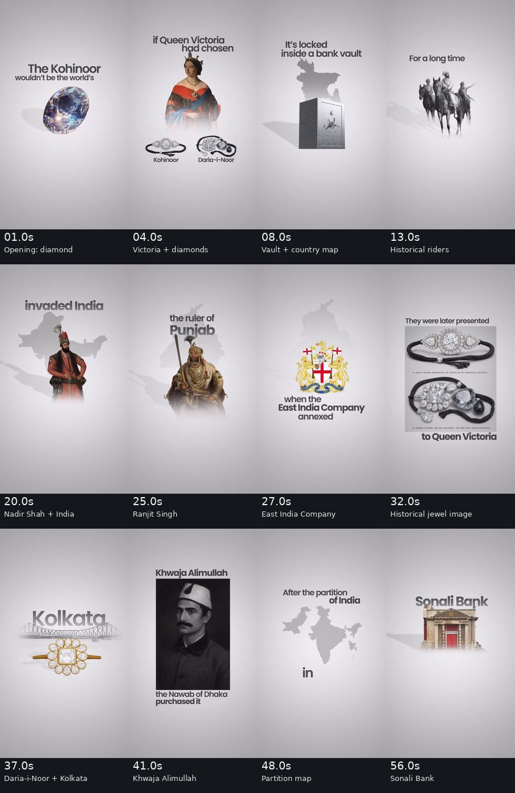
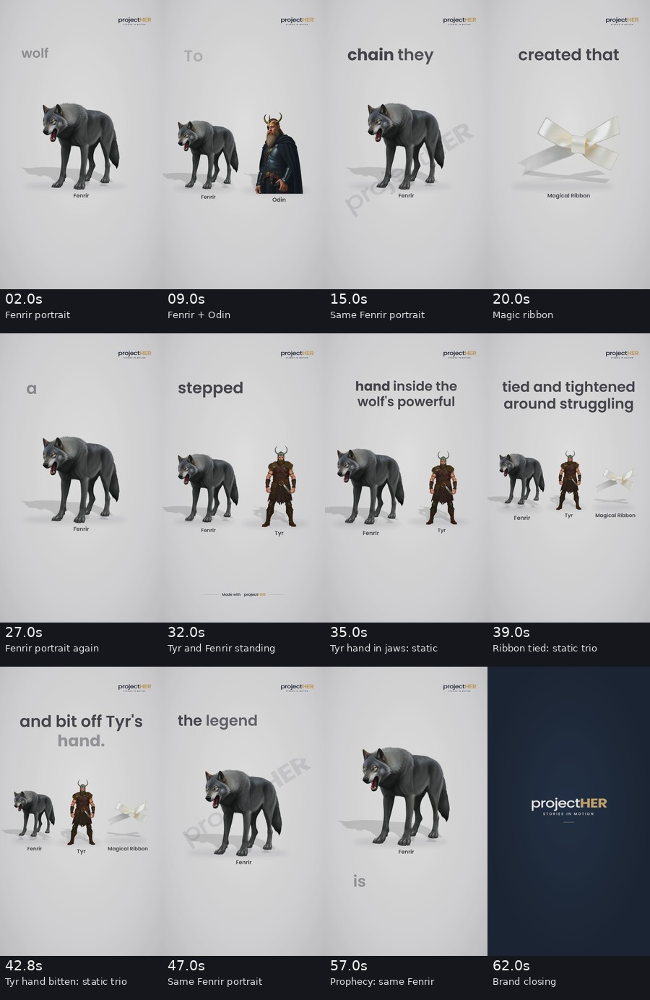

# ProjectHER — Visual Storytelling Audit + Implementation Master Prompt

**Source videos inspected**

- `reference-ai-video(6).mp4` — 58.211 seconds, 720 × 1280, 30 fps, historical explainer about the Koh-i-Noor and Daria-i-Noor diamonds.
- `project-her-f53324a2.mp4` — 63.146 seconds, 1080 × 1920, 30 fps, ProjectHER-generated Norse-mythology story about Fenrir.

**Analysis boundary:** This audit is grounded in inspected video frames and technical media metadata. No ProjectHER repository, deployment logs, internal generation traces, rendering profile, or model prompts were supplied. Any explanation of **why generation takes over ten minutes** is therefore a **hypothesis to test**, not a diagnosed root cause. Likewise, the videos have **different scripts**, so timestamp comparisons are about narrative visual direction, not whether two renderers reproduce identical scenes. Visual alignment recommendations below must be validated against the actual spoken audio and its timing metadata during implementation.

**Evidence storyboards:** Open `assets/reference_keyframes.jpg` and `assets/projecther_keyframes.jpg` (in this package). The labeled frames are sampled observations, not a claim that each sampled point is a complete shot.





---

# PART A — INSPECTED VIDEO COMPARISON

## A1. Executive diagnosis

The reference video repeatedly asks, **"What new person, object, place, action, or consequence does this part of the narration introduce?"** and changes or repurposes its visuals accordingly. ProjectHER asks, in effect, **"Which already-generated named entity is being mentioned?"** and frequently displays that entity's default portrait even when the narrative has advanced to an action or a consequence.

**Preserve ProjectHER's strengths:** recognizable recurring character images; coherent color/style; transparent/cutout-centered editorial compositions; several images occupying one scene; kinetic typography; deliberate shadows/motion; branding/watermark behavior; and its existing short brand outro. **Do not solve this by turning the entire output into full-bleed cinematic AI images.** Solve it with better selection and generation of **action cutouts** and **scene relationships**, then use the current graphics system to assemble them.

### Core conceptual rule

> **Same character does not mean same visual moment.** Reuse the character's identity, not necessarily the exact portrait pose. For important actions, show the same recognizable person/animal **doing the narrated action**.

New visual ≠ new model request. Existing action-appropriate assets can be reused; generated assets can be composed and animated into multiple beats. Do **not** force a fresh image for every spoken word or every sentence if the visual meaning has not changed.

## A2. Reference video's visual decisions, by time

| Approx. time | Observed reference visuals | Visual storytelling mechanism to learn |
|---|---|---|
| 0–2 s | Diamond in the opening and the Koh-i-Noor hook | The object of the hook becomes the immediate hero visual. |
| 2–6 s | Queen Victoria, two distinct diamond/jewelry objects, labeling/comparison | New decision-maker plus an **explicit visual comparison**, not just another diamond portrait. |
| 6–10 s | A vault plus geographic silhouette and Bangladesh labeling | The narration's **location and custody** become visible concepts; use symbolic assets when events are abstract. |
| 10–12 s | Mine/landscape image | Switch from person/object to **origin/location** when the story changes. |
| 12–17 s | Mounted rulers/warriors, text about Maratha and Mughal control | Historical ownership transition visualized with a **new period-specific subject**. |
| 18–22 s | Nadir Shah portrait, then map silhouette for invasion | Portrait is correctly reused while **the map adds the new action context**. Reuse is not inherently bad. |
| 23–26 s | Ranjit Singh portrait and Punjab labeling | Change protagonist when ownership moves to another figure. |
| 26–30 s | East India Company coat of arms, then jewelry in a framed presentation | Transition from individual ruler to institution, then back to the object affected by the event. |
| 31–35 s | Two jewel close-ups, Queen Victoria, crown, distinct text treatments | Mix **specific object, person, and symbol** to explain the chain of events. |
| 35–38 s | Daria-i-Noor jewel under India/Kolkata typographic/geographic treatment | Keep diamond identity but introduce location and movement. |
| 38–45 s | Photographs/portraits of Khwaja Alimullah and Nawab Salimullah, then jewel | Change visual when a distinct participant takes over a new action. |
| 47–51 s | Indian-subcontinent map with partition/1947 wording | Use **event-specific graphic** for geopolitical change. |
| 51–58 s | Kolkata context, then bank building and Sonali Bank text | End with the **current whereabouts** rather than returning to the opening diamond image. |

**Observed strength:** The reference often switches visual concept about every few seconds, while sometimes deliberately reusing a relevant historical portrait/diamond. It uses cutouts, symbols, archival photographs, maps, text hierarchy, fades and compositional transitions. It also does **not** require every visual to be photorealistic or a unique AI generation.

**Not the goal:** Copy all its typography, exact images, history claims, or background. Retain ProjectHER's design language and learn the reference's stronger *semantic image selection*.

## A3. ProjectHER's actual video, by time

| Approx. time | Observed ProjectHER output | Diagnosis / recommended improvement |
|---|---|---|
| 0–8 s | Prominent standing Fenrir cutout while captions introduce a wolf and prophecy | **Good identity introduction.** Keep. Add a relevant fate/prophecy symbol when the story shifts away from mere introduction. |
| 8–12 s | Fenrir + Odin appear together as the gods' concern is introduced | **Good multi-entity composition.** Keep and enhance their relationship/scale. |
| 12–18 s | Return to dominant standing Fenrir while the gods attempt to chain him | **Missed action:** a chain breaking or wolf resisting would be more informative than a standing portrait. |
| 18–24 s | A distinct magical ribbon cutout becomes the focal object | **Good object-focused visual selection.** Preserve this capability and the ribbon asset. |
| 24–30 s | Standing Fenrir image reused for suspicion, trap, promise of release | Continuity works, but suspicion/deception would benefit from **Fenrir looking at ribbon / defiant pose / hand-and-ribbon relationship**. |
| 31–36 s | Wolf and Tyr displayed as two separate standing cutouts while Tyr places his hand inside the wolf's jaws | **Severe missed action:** image should depict Tyr's hand visibly entering Fenrir's mouth (or a clear composited cutout pose showing this interaction). |
| 36–40 s | Wolf + Tyr + ribbon displayed together when the ribbon ties and tightens | **Good three-asset layout, wrong action state:** show ribbon physically looped and tightening around the wolf, not an unrelated floating ribbon. |
| 40–44 s | Same three standing/floating assets while Fenrir recognizes betrayal and bites off Tyr's hand | **Most important missed climax:** show action-specific Fenrir–Tyr interaction (non-gory, appropriate for the chosen editorial style). This beat should never be covered by the unchanged group portrait. |
| 44–47 s | Same three elements briefly, then standing Fenrir portrait | Gods' reaction/aftermath not sufficiently distinct; show bound Fenrir or response of gods. |
| 47–54 s | Fenrir's large standing cutout recurs as legend and eventual freedom are discussed | Show **the bound beast straining/escaping** or an appropriate transformation of the state. |
| 54–60 s | Fenrir still dominant during prophecy; later Odin added | Preserve Fenrir's identity but introduce the **prophecy conflict** (Fenrir vs. Odin, directional movement, rune/fate graphic). |
| ~61–63.15 s | ProjectHER dark-blue logo end card, “Stories in Motion” | **Keep.** Preserve closing timing/animation/configuration unless a separate branding requirement says otherwise. |

In the inspected samples, the current video relies heavily on **four principal illustrated assets** — Fenrir, Odin, Tyr and the magical ribbon — often reused as nearly identical poses. The reference cycles through a much wider set of **narratively distinct** visual objects/events. This is an asset-*meaning* gap, not just a raw asset-count gap.

## A4. Findings ranked by impact

| Priority | Gap | Why it matters | Fix |
|---|---|---|---|
| **P0** | Narrated action is rendered as entity portrait | Misses emotional and causal payoff | Structured **action/event extraction** before selecting assets. |
| **P0** | Climax looks like ordinary explanatory beat | Viewer sees no reason to care about the reveal | Action-aware hero asset and stronger emphasis for climactic beats. |
| **P0** | Existing asset reuse is driven primarily by identity | Repeated portrait even when scene state changes | Separate **identity reuse** from **pose/action asset reuse**. |
| **P1** | Visual scene planning appears too closely tied to named entities | Missing events, prop relationships, consequences | Narration → story beats → visual intent → asset plan → timeline. |
| **P1** | Multi-object compositions don't always show interactions | Wolf/Tyr/ribbon coexist but don't tell the action | Relative position, occlusion, arrows/tension, linked motion, or a generated action composite. |
| **P1** | Repeated layout over long windows | Good editorial aesthetic starts feeling static | Context-aware shot and composition variation, not arbitrary transitions. |
| **P1** | Large upper captions frequently dominate while imagery remains similar | Viewers read the story but don't visually experience it | Subordinate supporting text to action visuals on high-salience beats. |
| **P1** | >10 minute generation wait reported in deployed/embedded flows | Users may leave before seeing output | Instrument critical path, parallelize safely, cache, and profile export/deployment. |
| **P2** | Small entity labels and repeated brand marks can compete with visuals | Visual hierarchy is diluted | Preserve required branding but introduce responsive safe areas and configurable emphasis. |
| **P2** | End-stage visual QC absent/unconfirmed | Portrait fallback may pass silently | Semantic checks plus frame/clip storyboard inspection. |

## A5. Design standards to preserve

1. **Character identity:** An established wolf is still recognizably Fenrir; Tyr and Odin remain consistent in clothing, silhouettes, color/palette, face/hair or fur and accessories. Identity should be passed as references to action-asset generation whenever supported.
2. **Reusable assets:** Portraits are not forbidden; they are appropriate for introductions, returning to a subject, comparisons or non-action narration. Avoid re-generating duplicates.
3. **Multiple simultaneous assets:** Preserve two- and three-subject layouts, object comparisons, prop labels, depth, subtle shadows, staging, scale, kinetic type and independent motion.
4. **Cutout-first graphics:** Transparent or cleanly extracted characters, objects and action poses are assembled against the existing editorial scene background. A scene can have multiple cutouts or a single interaction cutout containing two linked subjects.
5. **Existing flow parity:** Keep article URL, text/topic, custom story, news/story modes, media options, narration options, captions, aspect ratios, branding/watermark and export integrations operational. Feature-flag the new planner and do not silently rewrite narration.
6. **Brand ending:** Preserve the ProjectHER closing card observed near the final 2 seconds, as well as existing watermark behavior, unless changing them is specifically requested separately.
7. **Accuracy and source ethics:** Avoid presenting invented archival photographs as authentic originals. For historical/mythological materials, use appropriate source verification/illustrative styles and attribute when required by the product's policy.

---

# PART B — CONCRETE NARRATIVE VISUAL TARGETS

## B1. Fenrir: recommended storyboarding for the actual current video

**Important:** These timestamps follow the generated MP4's visible cues. The final system must use **actual narration segment/word timing**, not fixed numbers copied from this example.

| Narrative beat | Visual direction | Reuse vs. generation decision |
|---|---|---|
| Introducing Fenrir | Big, recognizable standing wolf hero cutout | **Reuse `fenrir_identity` portrait.** |
| Prophecy frightens gods | Fenrir + Odin, optional subdued fate/rune symbol; negative space for hook | Reuse wolf/Odin; **add** fitting symbolic prop only when helpful. |
| Gods try to bind wolf | Wolf resisting/breaking ordinary chain, chain fragments | **New action pose/cutout** derived from Fenrir identity reference. |
| Magical ribbon introduced | Existing white magical ribbon enlarged with clean prop label | **Reuse existing ribbon.** |
| Fenrir suspects a trap | Cautious wolf in sideward pose examining ribbon; optionally Tyr gesture | New pose if needed; reuse ribbon and original identity. |
| Tyr offers his hand | **Tyr's hand clearly inside Fenrir's open jaws** | **Generate interaction-specific cutout** (or use an existing equivalent), preserve Tyr/Fenrir identities. |
| Ribbon begins to tighten | Fenrir's body/legs visibly encircled by ribbon, tether tugged | **Generate or composite bound Fenrir**; ribbon geometry/occlusion should indicate binding. |
| Fenrir understands betrayal | Angry trapped wolf + an abrupt focal switch to jaws/hand | New reaction variant or reframe valid action cutout. |
| Fenrir bites Tyr's hand | **The focal climax: wolf biting Tyr's extended arm/hand** with clear pose and non-gory implication | High-priority **new action-specific interaction asset**. Never default to two standing portraits. |
| Gods celebrate captivity | One or more gods reacting beside clearly bound wolf | Reuse identities + add context/reaction, if story warrants. |
| Fenrir remains imprisoned | Bound wolf straining at ribbon; strong directional pressure | Reuse the bound variant, motion for struggle rather than a static portrait. |
| Prophecy of Odin's death | Wolf vs. Odin, supported by ominous proximity/scale | **Reuse recognizable wolf and Odin**, but clarify the future conflict through pose/composition. |
| ProjectHER sign-off | Existing branded 2-second closing transition/end card | **Preserve untouched.** |

**Most important A/B visual test:** In the 31–44s portion of the current file, show Tyr's *hand action*, the ribbon *binding*, and Fenrir's *bite* as distinct meaningful states while preserving the same recognizable Fenrir and Tyr. Three standing icons beside each other are not an acceptable equivalent.

## B2. Sisyphus: separate required regression test

User's prior story illustrates a common algorithmic failure and must be a permanent fixture test:

| Story moment | Appropriate visual | Wrong visual |
|---|---|---|
| “Sisyphus was a king…” | Reusable king/person character cutout | No problem with an introductory portrait. |
| “The gods punished Sisyphus…” | Zeus/gods or a judgment motif plus Sisyphus, if narrated | Reusing only the king's portrait when punishment is the focus. |
| “He had to roll a boulder uphill…” | **Recognizable Sisyphus leaning into and PUSHING a giant boulder UP an inclined hill**, strained pose, uphill directional motion | Upright king portrait with a generic rock nearby or another unrelated character portrait. |
| “It rolled back down each time…” | Boulder visibly descending while Sisyphus looks defeated; same boulder/style/character where possible | Same static pushing pose without showing reversal. |
| “He had to repeat it forever…” | Repeat loop or visual progression of uphill/downhill; familiar character but event state changes | Repeated king portrait for the ending. |

Generate a new **action pose** with shared identity attributes (same clothing palette, hair/beard/skin cues/silhouette where possible), referencing the established Sisyphus portrait if supported. If a generated action image has imperfect facial identity, **prioritize a legible uphill struggle rather than using a perfectly matching but narratively wrong portrait.** Prefer better continuity when it is achievable without sacrificing story meaning.

## B3. Asset choice policy

Implement these decisions at **beat** granularity, not simply entity-name granularity:

- `REUSE_SAME_ASSET` — same person/object **and same action/state/purpose**, or useful continuity shot.
- `REUSE_WITH_COMPOSITION` — existing subjects plus text/map/prop/vector shape produce the new meaning convincingly.
- `GENERATE_ACTION_VARIANT` — character persists but changes pose or performs a new meaningful action.
- `GENERATE_INTERACTION_CUTOUT` — a physical relationship (wolf bites hand, person pushes boulder, rope binds wolf) requires credible contact/occlusion. Composite can represent multiple entities in one cutout.
- `GENERATE_NEW_ENTITY_OR_PROP` — newly introduced person, tool, place, symbol, item or consequence.
- `GENERATE_EVENT_CONTEXT` — location/map/event visualization beats that don't call for a person portrait.
- `TEXT_OR_VECTOR_ONLY` — dates, places, comparisons, diagrams and transitional context best presented through graphics.

A sentence may map to multiple tightly related beats if it changes event; two sentences may share one meaningful visual if they're one event. Do not generate gratuitous images just to increase the count.

---

# PART C — MASTER IMPLEMENTATION PROMPT FOR THE CODING AGENT

> **BEGIN COPY-READY IMPLEMENTATION INSTRUCTIONS**
>
> You are the lead engineer, visual-storytelling director, media-pipeline architect and performance investigator for **ProjectHER**. Implement a **narrative-aware cutout visual planning system** and **faster end-to-end generation** without regressing its existing functionality or video quality.
>
> **Do not build a new unrelated app, remove existing features, or swap out the current rendering pipeline unnecessarily.** First inspect the actual repository and identify its current flow, modes, LLM calls, TTS, image provider adapters, subject/image asset cache, cutout/background-removal logic, scene JSON, Remotion or other renderer, caption timing, FFmpeg/export layer, branding, backend API, queue/storage, and hosting integration. Adapt the specification below to the **actual architecture**. If relevant modules already exist, upgrade them rather than introducing a second competing implementation.
>
> **Sources to read first:** this Markdown document; `assets/reference_keyframes.jpg`; `assets/projecther_keyframes.jpg`; and, if accessible, both reference/ProjectHER MP4 files. Treat the screenshots as evidence of current output, not as full video substitutes.

## C1. Non-negotiable product requirements

1. Every **important narrative beat** must have an image, interaction, or context graphic semantically appropriate to that beat.
2. A recurring character must retain recognizable identity across beats; **reuse original established imagery when its depicted pose/action is relevant**.
3. A newly narrated **action** must not silently collapse to a recurring character's **default portrait** if that fails to depict the action.
4. An **action-specific cutout** should be possible even when the depicted character appeared earlier. Provide image-conditioned generation or a continuity-preserving fallback.
5. Preserve and extend multi-image compositing, individual layer animation, cutout appearance, typography, shadows, visual labels and scene transitions.
6. The output must remain compelling for **news, myths, history, explainers, user-entered original stories** and other supported modes, without hard-coded wolf/Sisyphus cases.
7. Preserve voiceover, optional sound/background soundtrack, captions and alignment, resolution/fps/export quality, branding/watermark, signature closing, website embed and existing API compatibility.
8. Reduce the **actual total job wall time** for published and embedded users. Do not achieve speed by reducing narration quality, skipping required images, downgrading output quality, or eliminating interesting scenes.
9. Produce testable measurements of both quality and latency before declaring success.
10. Implement incrementally behind a flag with backward-compatible fallback and clear rollback.

## C2. First task: audit and architecture mapping (before edits)

Draw current call/data graph:

```
Input (URL/topic/story)
  -> extraction/normalization
  -> story research and/or narration script
  -> entity detection / visual plan (existing?)
  -> TTS, precise timing and captions
  -> visual prompts and assets
  -> image generation and cutout processing
  -> scene/layout/motion timeline
  -> rendered composition
  -> FFmpeg/encoding/audio mux
  -> storage/URLs/results + embed UI
```

List: real modules, important function names, intermediate schemas, service boundaries, external calls, concurrency, potential blocking awaits, number of image generations, estimated output assets, and which dependencies truly gate each other. Identify duplicated work and repeat requests. Avoid speculative rewrites; propose a short, concrete implementation plan with files to touch and relevant existing tests.

**Do not pause after the plan if normal coding-agent execution is authorized; implement and verify.** For any unknown external provider behavior, use the actual provider documentation/API adapter and handle unavailable capabilities gracefully.

## C3. Introduce `NarrativeBeatPlan` (structured semantic story analysis)

Create one canonical, versioned plan that captures **story action, actor, object, location, state change, emotion and visual significance**, not just named entities or a bag of image queries.

Suggested adaptable shape:

```json
{
  "plan_version": "narrative-v2",
  "story_id": "job-id",
  "entities": [
    {
      "entity_id": "fenrir",
      "type": "character",
      "identity_asset_id": "fenrir-master",
      "visual_identity": {
        "species_or_description": "large gray mythical wolf",
        "palette": ["charcoal", "slate gray"],
        "distinctive_features": ["large muzzle", "dark fur"],
        "reference_image_ids": ["fenrir-master"]
      }
    }
  ],
  "beats": [
    {
      "beat_id": "b08",
      "narration_span": {
        "text": "Tyr placed his hand inside the wolf's jaws.",
        "script_start_char": 283,
        "script_end_char": 330
      },
      "timing": {
        "start_ms": null,
        "end_ms": null,
        "alignment_confidence": null
      },
      "narrative": {
        "kind": "physical_action",
        "actor_ids": ["tyr"],
        "target_ids": ["fenrir"],
        "verb": "place_hand_inside_jaws",
        "affected_object": "Tyr's hand",
        "result_state": "hand inside open wolf mouth",
        "narrative_priority": 0.95
      },
      "visual": {
        "visual_goal": "Show Tyr physically placing his hand in Fenrir's mouth",
        "primary_subject": "Tyr's hand in Fenrir's jaws",
        "decision": "GENERATE_INTERACTION_CUTOUT",
        "asset_ids": ["fenrir-tyr-jaws-action"],
        "identity_reference_ids": ["fenrir-master", "tyr-master"],
        "required_action_visible": true,
        "cutout_required": true,
        "suggested_composition": "interaction_hero",
        "motion_intent": "hand_reaches_jaws",
        "importance": "high"
      }
    }
  ]
}
```

All actual fields should use typed validation (e.g., Pydantic/Zod/JSON Schema consistent with the repo), defensive parsing, stable IDs, plan versioning, logging and serialization; JSON above is illustrative. Model outputs are untrusted and must be validated. Script indices and timing must be determined from actual script/audio; do not copy these example offsets blindly.

**Segmentation rules:**

- Detect **events** and meaningful changes: action (bite, push, bind), object (boulder, ribbon), person, historical institution, place, state, conflict, decision, consequence, reveal.
- Identify what **the viewer must see** at that instant; nouns alone are insufficient.
- Give priority to physical verbs and turning points. Recognize climax, contrast, surprise, stakes and cause/effect.
- Support several narrative sentences sharing one event, or one long sentence containing sequential events.
- Avoid one image per punctuation mark, word or caption fragment. Derive beats from semantics and final speech timings.
- Treat reused identities and newly needed action poses separately.
- Produce a clear visual fallback if narration is abstract or image generation fails.
- Expose mode-specific presets but keep common planner logic. For local stories without online references, do not invent alleged historical provenance.

## C4. New asset architecture: character continuity + event-specific views

Represent the visual assets explicitly:

```
Entity Identity Pack
  entity_id, master portrait/cutout, stable clothing/fur/face/props,
  reference images, prompt seed or style guide (where supported)

Action Asset Variants
  entity_id(s), action_verb, before/after state, interaction target,
  pose, camera angle, key prop, continuity references, transparent image,
  crop geometry, provenance, confidence, cache key

Composed Scene
  beat_id, references to one or more assets, layer order/positions,
  labels, motion specs, narration timestamps, branding overlays
```

**Must implement:**

1. A **single reusable entity identity pack** established on first meaningful introduction. Store explicit identity cues and the associated asset IDs.
2. On a new action, ask: Can existing assets plus shapes/motion **clearly depict** this action? If yes, reuse. If no, create an action pose or interaction cutout conditioned on identity references where supported.
3. For high-salience physical interaction (hand in jaw; boulder pushed uphill), prioritize an **interaction asset** or realistic layered interaction with overlap/occlusion. Do not independently float unrelated standing sprites and label it an interaction.
4. Retain existing transparent-background/cutout processing and clean edge mattes. Ensure the key action/props survive background removal (hands, chains, ribbons, boulder contours).
5. Use scene-dependent scale/anchor, focal subject, subject-direction, z-index, shadows, depth and responsive safe regions. Avoid cutting off the important hand/boulder/chain.
6. Track original image, processed transparent image, visual reference IDs, asset purpose and where reused. Never regenerate a duplicate solely because an entity appears later.
7. Fallback sequence: action asset available → compose from identity + prop with convincing behavior → generate continuity-guided action variant → best semantic alternative with clear metaphor. **Do not quietly fall straight back to generic portrait.** Mark degraded visual match and expose it to QC.
8. Preserve artistic continuity; when perfect facial identity is impossible, **narrative action relevance takes precedence** over a wholly unrelated default pose.

**Prompt example, Sisyphus action asset:**

```
An editorial transparent-background character-action illustration:
Sisyphus, visually consistent with the established king portrait
(same clothes palette, hair/beard and silhouette when reference permits),
leaning forward with both hands pressed firmly against a massive round
stone boulder, using obvious physical effort to roll it UP a steep slope.
Dynamic action pose; torso bent, planted foot, visible contact with rock;
clean silhouette and full key action in frame; believable gravity.
Cutout-first editorial styling matching the source video, soft grounded
shadow, no text, no title, no watermark, no unrelated characters.
Transparent PNG or high-quality removable background. Render subject and
boulder as one interaction pose unless separate layering preserves contact.
```

**Prompt example, Fenrir climax:**

```
Editorial cutout action scene matching saved Fenrir and Tyr identities.
Large charcoal-gray mythical wolf Fenrir with jaws visibly clamped on
Tyr's extended hand/forearm; Tyr in the same Norse armor and palette as
his established identity. Strong readable physical interaction, visible
faces and dramatic but tasteful pose, consistent light and cutout style.
No blood, gore or severed body parts required; implication is sufficient.
No caption/text, no scenery filling the frame. Allow alpha extraction;
protect fine edges at hand/wolf mouth and pose. Leave composition room
for typography and later layer motion.
```

## C5. Visual decision scoring and quality gates

Create a deterministic, inspectable scoring/check layer *after* the semantic planner proposes an asset decision. Evaluate candidate visual representation by:

- **Narrative relevance:** Does it depict the new **event/action/state**, not merely the right named person?
- **Action visibility:** For concrete verbs, is the action perceptible at phone size without reading the caption?
- **Continuity:** Are returning character identities and design language respected?
- **Composition:** Are key actor, object and prop visible, non-overlapping in harmful ways, with correct orientation/occlusion?
- **Variation:** Is the proposed shot meaningfully different when narration changes? Is the repeat purposeful rather than lazy?
- **Asset feasibility / latency:** Can an existing suitable asset be reused instead of an expensive redundant request?

**Hard reject rule:** If a beat is marked `physical_action` and `required_action_visible=true`, a candidate consisting solely of the named character's unchanged **standing portrait** cannot score as semantically complete. Either obtain a suitable visual or explicitly flag a degraded scene for fallback/review. The system must not game this with a trivial zoom, rotation or a new file containing the same portrait.

For optional weighting, prioritize relevance/action over identity and novelty. Treat scores as heuristics to tune via test samples, not authoritative ground truth. Record the reason for each visual decision in diagnostics.

## C6. Narrative-to-audio-to-timeline alignment

1. Preserve existing script and TTS output. Obtain final TTS word/segment timestamps where the provider exposes them.
2. When word timestamps aren't supplied, do a **single forced alignment** of final audio to the final script, with confidence/quality checking. Avoid guessing that subtitles and events line up by character count or fixed words-per-second.
3. Map each narrative beat's script span to the aligned audio start/end (including pauses and punctuation differences). Handle contractions, repeated words, quotes, edits and normalization.
4. Trigger main hero image entry **close to the onset of the spoken event**, not many seconds before or after. An important action image should hold through enough of the event for comprehension.
5. Allow an image from one coherent event to persist across multiple closely related speech fragments. If the story introduces a new central action/prop, cause a corresponding visible change.
6. Drive caption timing and scene placement from the **same timebase**, retain current kinetic text style, and prevent clipping/orphaned words or illegible overlap. Keep transitions bounded so a key action is not hidden behind a wipe or exit animation.
7. Use a speaker/voice-independent timing algorithm so both local and deployed renders behave consistently.
8. Keep existing music ducking, audio muxing, subtitle options and narration quality. Do not alter pacing of the actual voice to force pictures to fit.

Suggested configurable creative defaults (not hard constraints): typical visual beats ~2–4 seconds, faster only where action demands it; action reveal within roughly ±0.5 s of related narration onset; hold key action at readable phone size; allow a multi-part event to stay visually coherent longer.

## C7. Scene composition and motion upgrades, without losing ProjectHER's look

Keep existing templates. Add or refine only as needed:

| Template | Intended use | Example |
|---|---|---|
| `character_intro` | Main character debut | Fenrir hero cutout |
| `object_hero` | Newly mentioned object | Magic ribbon |
| `subject_comparison` | Choice/contrast/relationship | Queen with two diamonds |
| `subject_interaction` | Two entities physically affecting one another | Fenrir biting Tyr's hand |
| `physical_action` | Action on prop or environment | Sisyphus pushing boulder |
| `event_context` | Geographic/history events, maps, institutions | Company annexation/partition |
| `three_asset_story` | Explicit actor + prop + consequence | Tyr, bound wolf, tightening ribbon |
| `reaction_or_aftermath` | Change of state/emotional payoff | Trapped wolf and gods' response |
| `foreshadow_reveal` | Suspense and closing story twist | Wolf–Odin prophecy |

**Motion requirements:** Directional entering elements when introduced, staggered multi-asset movement, subtle object parallax, layout morphs, zoom emphasis on action and physical cause→effect motion. For Fenrir ribbon scene, ribbon must visually surround/tighten around wolf; for Sisyphus, boulder must move uphill and reverse downhill. Preserve readable silhouettes; prefer restrained premium motion over excessive shake or constant zoom.

Make images and typography responsive in vertical 9:16 and other supported aspect ratios. Respect on-screen text areas, logo/watermark and end card; never crowd focal actions out with overlarge text. Keep the original editorial palette unless the product's existing style setting indicates otherwise.

## C8. Optimize the end-to-end generation time scientifically

**Current symptom:** User reports deployed ProjectHER and the klinteng.com embedded use flow can exceed **10 minutes** for approximately one-minute output. Exported MP4s cannot reveal which stage is slow. Instrument **first**.

### C8a. Required instrumentation

Introduce per-job spans (real wall-clock start/end, duration, success/fail, count, cost where available) for:

```
queue_wait
input_fetch_and_extract
research_or_script_generation
semantic_beat_planning
entity_identity_asset_generation
new_action_asset_generation
image_provider_wait
background_removal_and_alpha
TTS_generation
word_forced_alignment
scene_planning_and_layout
asset_upload_or_download
Remotion_or_other_render
FFmpeg_encode_and_mux
result_upload
end_to_end
```

Log job correlation IDs, stage concurrency, provider retry/backoff and failures, cache hit/miss, image count, duplicate prompt count, asset sizes, output length/resolution/fps and Cloud runtime CPU/memory settings. Do **not** log secrets, protected user text/URLs or raw media content indiscriminately. Expose opt-in developer diagnostics and an end-user coarse progress indicator using actual stages, not made-up percentages.

Report **critical path**, not merely sum of all parallel stage durations. Collect both local and deployed runs (and embedded UI initiation). Compare p50/p95, first preview, failure/retry rate and quality metrics; a single fast run is not proof.

### C8b. Safe dependency-aware concurrency

Do **not** simply run everything sequentially. Establish the narration/beat plan early, then:

1. Lock recurring **master identity packs** before sending their derived action requests where reference-conditioning is needed.
2. Once master identities and beat semantics are known, schedule **independent new scene/action images in bounded parallel**, respecting provider rate limits, cost, RAM and image-consistency dependencies.
3. Let TTS and the visual asset-generation pipeline progress concurrently where their input dependencies permit; obtain alignment from finished audio and bind the plan to the exact timestamps before final composition.
4. Perform background extraction as each unique image completes, not only after *all* images finish, and cache the extraction output.
5. Prepare static graphics, fonts, motion templates, common layouts and scene metadata while images are in flight.
6. Render **once** from the finalized timeline unless the exporter truly needs segmented rendering; avoid repeated re-renders per minor scene change.
7. Use bounded worker pools/semaphores, cancellation and idempotent retries so concurrency improvements do not cause provider throttling, OOM, corrupted output or duplicated paid requests.

### C8c. Cache and de-duplicate correctly

Create a content-addressable asset cache keyed by **story requirements**, model/version, style preset, identity reference version, prompt semantics, target dimensions and processing version. Track public/shared assets separately from user-provided private assets. Use durable cloud object storage where multiple workers or Cloud Run instances must share state; ephemeral local container files alone are not a reliable deployment cache.

- **Good dedup:** reuse Fenrir's initial portrait for a later character-introduction shot, reuse identical ribbon cutout, reuse a processed PNG matte.
- **Bad dedup:** reuse standing Fenrir portrait for `Fenrir bites Tyr's hand` just because `entity_id=fenrir`; reuse royal portrait for `Sisyphus pushes boulder`.
- Cache expensive outputs such as TTS for unchanged input/settings where appropriate and permissible, preprocessed sprites and static template resources; invalidate when prompt, voice, identity, style or versions change.
- Preserve privacy, expiry, ownership, tenant isolation and rights restrictions for supplied images/text.

### C8d. Render and deployment performance investigation

Inspect the **actual** encoder and renderer (Remotion/FFmpeg/browser where present). Benchmark CPU profiles, bundle caching, frame rendering/concurrency, decoding, background-removal overhead, repeated asset transformations, disk I/O and number of full encode passes. Tune thread/concurrency and memory jointly; more workers can make Cloud Run slower under CPU/memory caps. Reuse textures/assets and avoid remounting/canvas reprocessing per frame if current stack permits.

Maintain original **1080×1920, 30fps** for the ProjectHER example and equivalent quality settings for other outputs. Test any faster encoder preset using comparative bitrate and perceptual quality (VMAF/SSIM where available + human review); do not claim equal quality from preset changes alone. Hardware encoding only when verified available and comparable quality. Do not downgrade still-image resolution or skip hero images.

For deployed service and klinteng.com embed, investigate backend request timeouts, cold starts, queue time, TTS/image network waits, upload/download duplication, blob transit through frontend, polling, upload consistency, and retries. If generation is long-running, use durable **async job IDs** with an appropriate queue/worker model (e.g., existing job system or Cloud Run Jobs where suitable), object storage and SSE/WebSocket/poll status. Preserve the current API contract or introduce versioned adapters. The website should submit once and display real progress/results; it should not accidentally trigger duplicate generations upon refresh/navigation.

### C8e. Performance goals and non-goals

Establish the baseline on **at least 10 comparable ~60-second videos** with cold and warm caches separated. Then target an initial **25–40% p50 latency reduction without quality regression** (for a 10-minute job, roughly 6–7.5 minutes) and work toward **under six minutes** only if measurements and provider limits make it feasible. These are engineering **targets, not guarantees**. Report p95 separately and prevent catastrophic long-tail jobs. Do not add high-salience action images so recklessly that all the concurrency gains disappear; use a deliberate image budget based on semantic events, not word counts.

## C9. Specific validation suite (must pass)

**Golden test A: Fenrir (~63s)** — Use the same or closely equivalent existing script. Confirm:

- Established wolf, Odin, Tyr, and ribbon have stable visual identities.
- At least three distinct *meaningful action states* appear for Tyr's hand-in-jaws, ribbon tightening, and Fenrir's bite (not three copies of the standing characters).
- The magical ribbon remains visible and spatially attached when binding is mentioned.
- Non-gory climactic action is immediately understandable with captions off.
- Three-asset composition still works; existing single-cutout intro still works; narration/captions sync; branded ending stays intact.

**Golden test B: Sisyphus** — On its climax, a person actually pushes/rolls a boulder **uphill**, and the boulder rolls back down when narrated. Visual match is more important than default king portrait repetition. Preserve clothing/person identity where feasible.

**Golden test C: Reference-style history** — Use a generic history script with several changes in named people, object custody, map/place, institution, date and present-day status. Verify the plan selects the *new focal concept* as context advances and sometimes validly reuses prior relevant diamond/person assets.

**Golden test D: Original local news/custom story** — With no external sources, generate visual scenes from user-supplied information without falsely implying that generated visuals are real photographs of an event or fabricating source citations.

**Golden test E: Scene continuity** — Repeated character references should remain recognizable and not randomly switch clothes/fur/face. Intentional variants should still be the correct character.

**Golden test F: Missing asset / provider rate limit** — Gracefully retry with bounded backoff, use semantically relevant fallbacks, log degraded beats and complete the job without broken image holes or fake success.

**Golden test G: All existing modes/regression** — Article URL, topic/text, news/story generation, narration options, cutouts, multi-image scenes, captions, image modes, branding/watermark, outro, response/output API, website embed and 9:16 export remain operational.

**Golden test H: Latency** — Compare the exact same scripts/duration/resolution/provider configuration before/after, including deployed runs. Preserve image variety and quality. Track all stages and job total p50/p95; verify no hidden repeated render, extra image fetch or duplicate submissions.

### Candidate quantitative quality metrics

- `action_beat_coverage`: percentage of manually labeled high-priority action beats with a legible action/event visual. **Target: ≥90%** on golden tests.
- `climax_mismatch_count`: number of climaxes represented only by unchanged identity portrait. **Target: 0**.
- `unjustified_asset_repeats`: repeated image/pose across a *different high-priority event* without visible context change. **Target: 0 on scripted tests**.
- `identity_consistency`: reviewer score for recurring assets — do not demand pixel identity between differently posed action variants.
- `visual_beat_alignment`: reviewer score for whether key image appears near narration's key phrase.
- `multi_asset_composition_pass`: previous good scenes must remain present/functional.
- `subtitle_and_branding_regressions`: **0** accepted regressions.
- `quality_vs_latency`: compare image/cutout artifacts, export sharpness, dropped frames, audio sync and end-to-end latency.

Use actual screenshot/storyboard and final-video review, not only unit tests that validate JSON shape.

## C10. Engineering execution order

**Phase 0 — Baseline:** Trace pipeline and deployed path; measure job spans; record output from current Fenrir test; identify image and renderer bottlenecks. Produce concise discovery notes.

**Phase 1 — Visual intelligence (P0):** Versioned beat schema, action/actor/target/state extraction, priority scoring, structured decision trace, fallback; write fixture tests.

**Phase 2 — Asset pipeline (P0):** Identity packs + reference-conditioned action variants/interactions + processed cutout cache. Preserve current asset reuse and multi-image compositing.

**Phase 3 — Composition & sync (P1):** Action templates, physically meaningful layered relationship, timing aligned to audio, climactic emphasis, no layout/text regressions.

**Phase 4 — Safe speed (P0/P1):** Critical-path parallelism, bounded image jobs, per-asset async matte extraction, dedup/cache, renderer profiling, durable host job orchestration as required, website progress integration.

**Phase 5 — QC & regression:** Generate complete Fenrir and Sisyphus videos, inspect all key beats, compare side-by-side with baseline/reference principles, run complete mode regression, record timings and quality scores, improve until gates pass.

**Phase 6 — Rollout:** Feature flags (`narrative_visual_planner_v2`, `action_assets_v2`, `parallel_asset_pipeline_v2` or equivalent), canary/profiling in deployment, rollback switches, persistent schema versioning, documentation and migration compatibility.

### Implementation boundaries

- Do not hard-code prompts solely for Sisyphus and Fenrir; they are acceptance fixtures.
- Do not equate more images with better storytelling. **Semantic action coverage** is the KPI.
- Do not solve identity by only reusing the same default portrait.
- Do not sacrifice continuity solely to produce random new imagery.
- Do not convert the art style into full-screen illustrations instead of ProjectHER's cutout motion graphics.
- Do not delete or obscure the ProjectHER watermark, outro, audio/caption features or multi-image motion.
- Do not rebuild the entire frontend/backend if targeted changes suffice.
- Do not claim the 10-minute wait is due to LLM/image generation/rendering before measuring it.
- Do not prematurely mark work complete after writing only a plan, mockup or unconnected modules.

## C11. Final coding-agent deliverables

1. **Root-cause report** with real baseline timings (including production vs local/embedded differences where accessible) and current data flow.
2. **Code changes**, integrated into the existing app, with relevant paths/changes and backward compatibility notes.
3. **Documented schemas and configuration**, logging, cache policies, flags, job lifecycle, retries and fallback behavior.
4. **Before/after scene timeline** for Fenrir and Sisyphus showing the narrative beat, selected asset(s), reuse/new decision and action visibility.
5. **Actual rendered MP4s/screenshots** validating crucial moments, captions, cutout style, multi-asset layouts, stable characters and signature end card.
6. **Benchmark report**: end-to-end wall time, p50/p95, per-stage elapsed, image count/unique action assets/cache hit ratio, API usage/cost where available and comparable visual quality.
7. **Completed automated tests + manual review checklist** and remaining known limitations.
8. **Deployment + klinteng.com embedding verification**: one submission/one job, robust progress, eventual playable result, failure/retry state and no duplicative rendering.

**Definition of success:** A viewer hearing “Tyr placed his hand inside Fenrir’s jaws” actually **sees that interaction**. A viewer hearing “Sisyphus pushed the boulder uphill” actually **sees the boulder being pushed uphill**. Recurring heroes remain recognizable, attractive cutout compositions/motion remain, the branded ending remains, and production jobs complete measurably faster with no material quality regressions.

> **END COPY-READY IMPLEMENTATION INSTRUCTIONS**

---

# PART D — QUICK DECISION CHECKLIST FOR REVIEW

- [ ] Each event has a visually meaningful subject/action/location/object.
- [ ] Introductory character portrait used where appropriate — never as automatic substitute for action.
- [ ] Same character stays recognizable across different poses and contexts.
- [ ] Dramatic verbs and story climaxes have physically readable cutout scenes.
- [ ] Multi-object layers and motion graphics remain better than before.
- [ ] Alpha extraction preserves hands, ropes, chains, boulders, clothing and hair/fur.
- [ ] Captions align with actual spoken speech; typography does not hide the action.
- [ ] Narrative scene diversity increases without useless image churn.
- [ ] Brand/watermark and signature closing are preserved.
- [ ] News, article, topic and custom-story workflows still work.
- [ ] Actual end-to-end production duration and stage spans are measured.
- [ ] Image/TTS/provider calls and preprocessing are cached/parallelized responsibly.
- [ ] Renderer/export quality unchanged or objectively demonstrated equivalent.
- [ ] klinteng.com embed does not duplicate generation, and reports true status.
- [ ] Full rendered Fenrir and Sisyphus regression tests visually pass.

**Highest-value result to verify first:** Rewrite the *visual scene plan* for the existing Fenrir video **without changing the narration or the visual brand**. If the 31–44s sequence now clearly shows hand → binding → bite rather than a repeating row of portraits, the fundamental story-direction gap has been solved. Then improve the performance of that exact higher-quality pipeline, preserving its result.
